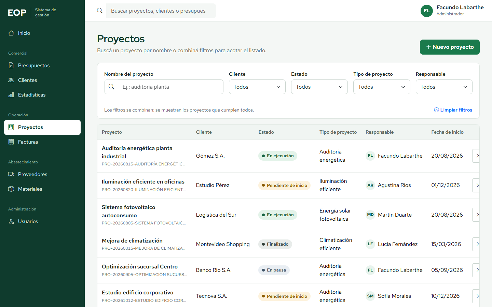
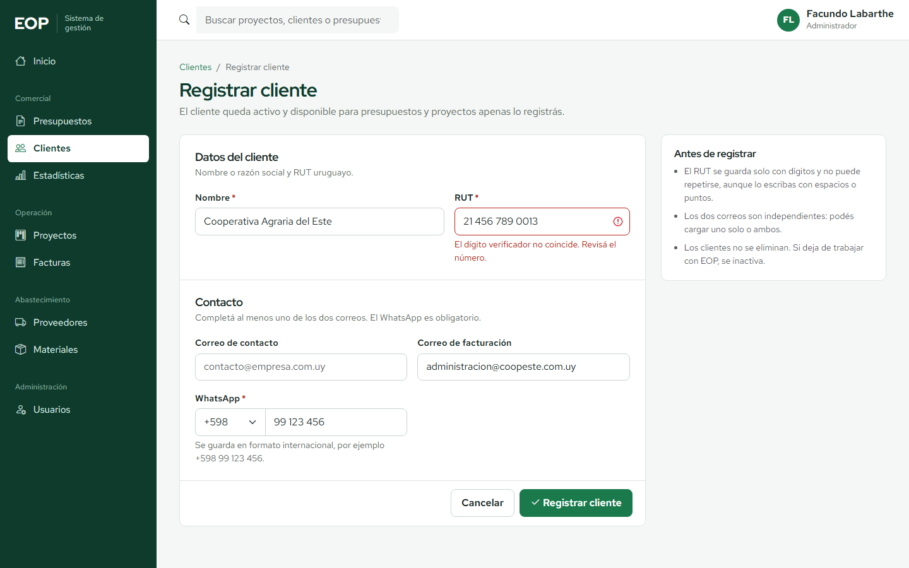
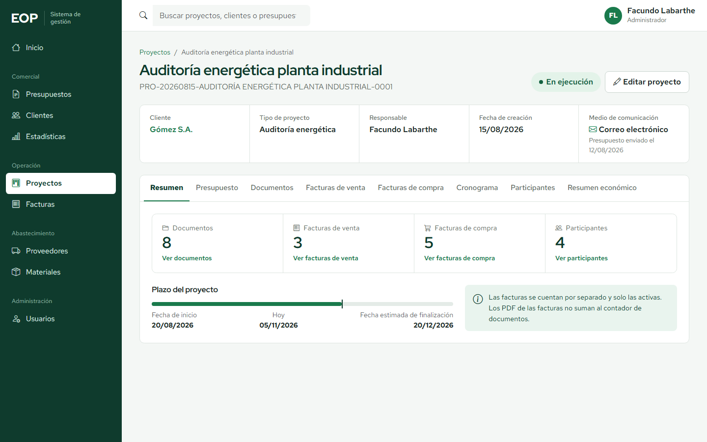
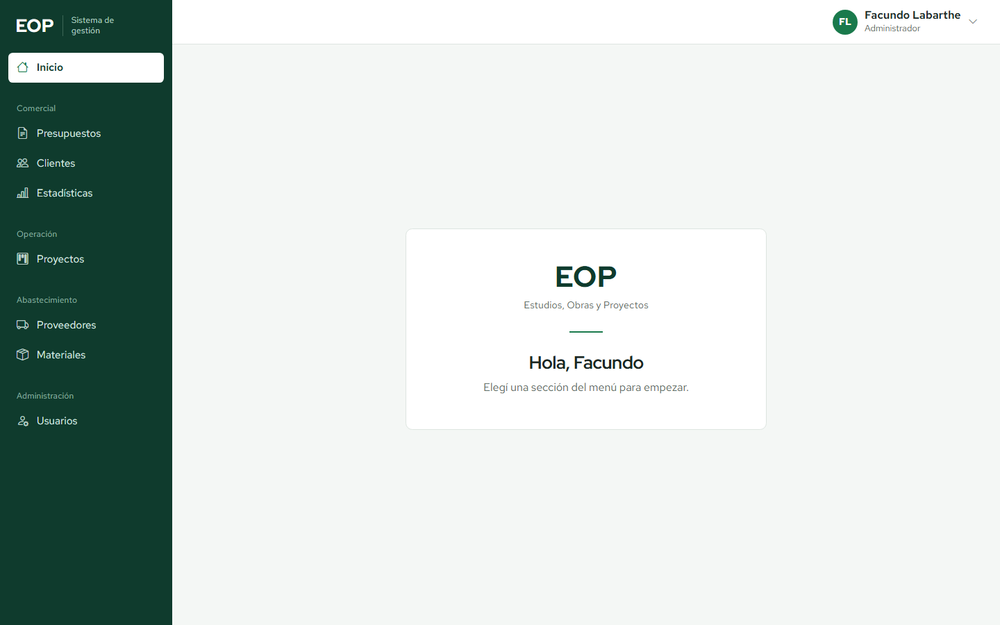

# Diseño visual de EOP

Guía de estilo del Sistema de Gestión EOP. Define cómo se ven y se comportan las pantallas
para que cualquier persona o asistente (Claude Code o Codex) pueda construir una pantalla
nueva con la misma apariencia que el resto.

| | |
|---|---|
| **Diseño elegido** | Alternativa A — Corporativa moderna |
| **Base técnica** | Bootstrap 5.3.3 (la versión de `wwwroot/lib/bootstrap`) + una hoja de estilos propia |
| **Requerimientos que cubre** | RNF-1, RNF-4, RNF-10, RNF-13, RNF-14, RNF-15, RNF-16, RNF-18, RNF-19, RNF-20 |
| **Última actualización** | 05/11/2026 |

## Estado de la guía

| Parte | Contenido | Estado |
|---|---|---|
| [Parte A](#parte-a--decisiones-visuales-aprobadas) | Decisiones visuales aprobadas por el equipo (secciones 1 a 21) | **Aprobada** |
| [Parte B](#parte-b--validación-con-el-cliente) | Validaciones del cliente (tipografía y colores) | **Validada por el cliente** |
| [Parte C](#parte-c--pantalla-de-inicio) | Pantalla de inicio: panel de bienvenida | **Aprobada** |
| [Parte D](#parte-d--detalles-que-se-resuelven-al-implementar-cada-funcionalidad) | Detalles que se resuelven al implementar cada funcionalidad | Se completa tarea por tarea |
| [Apéndice](#apéndice--hoja-de-estilos-de-referencia) | Hoja de estilos de referencia, lista para copiar | Aprobada |

## Cómo usar esta guía

- Antes de crear o modificar una vista Razor, leé las secciones de los componentes que vas
  a usar y copiá sus valores. **No inventes colores, tamaños ni componentes nuevos** si acá
  ya hay uno que resuelve el caso.
- Si una pantalla necesita algo que la guía no cubre, resolvelo con los tokens existentes
  (sección 3) y proponé el agregado a esta guía para que el equipo lo apruebe.
- **Los requerimientos mandan.** Esta guía define *cómo se ve* algo, nunca *qué hace* ni
  *quién puede hacerlo*. Qué datos, columnas, filtros, acciones y permisos tiene cada
  pantalla sale de `docs/historias-de-usuario/user-stories.md`, `docs/requerimientos/requerimientos-funcionales.md` y
  `docs/requerimientos/alcance.md`. Si una captura muestra algo que los requerimientos no piden, no se implementa.
- Ocultar un botón según el rol es solo comodidad visual. El control de acceso siempre se
  verifica en el servidor (RNF-4, RF-73, ver `AGENTS.md`).
- La Skill `frontend-design` puede usarse como apoyo de criterio general, pero **las
  decisiones visuales de EOP son las de este documento**. Ante cualquier diferencia, gana esta guía.
- Los prototipos HTML que se usaron para diseñar viven fuera del repositorio y son
  temporales. **La referencia válida es este documento**: los valores de las secciones y la
  hoja de estilos del [Apéndice](#apéndice--hoja-de-estilos-de-referencia).

---

# Parte A — Decisiones visuales aprobadas

## 1. Imágenes de referencia

Capturas a 1440 × 900 px de los prototipos aprobados de la alternativa A. Muestran el
estilo general; las correcciones posteriores a la aprobación (sin buscador global, sin
«Facturas» en el menú, borde de campos más oscuro, tabla corregida) están descriptas en las
secciones 7, 8, 13 y 14 y tienen prioridad sobre lo que se ve en las imágenes.

**Listado con filtros** (US-025)



**Formulario de registro** (US-053), con un error de validación a la vista



**Ficha de un registro con secciones** (US-028)



Archivos en [`docs/diseno-visual/referencias/`](referencias/):

- [`alternativa-a-listado.png`](referencias/alternativa-a-listado.png)
- [`alternativa-a-formulario.png`](referencias/alternativa-a-formulario.png)
- [`alternativa-a-proyecto.png`](referencias/alternativa-a-proyecto.png)
- [`alternativa-a-inicio.png`](referencias/alternativa-a-inicio.png) — pantalla de inicio, ver [Parte C](#parte-c--pantalla-de-inicio)

---

## 2. Principios

1. **Sobrio y legible antes que decorativo.** Fondo gris verdoso muy claro, paneles blancos,
   un solo verde para las acciones. Sin degradados, sin sombras decorativas, sin ilustraciones.
2. **El verde indica dónde actuar o dónde estás.** Verde bosque para la navegación, verde EOP
   para el botón principal, los enlaces y el elemento activo. No se usa verde como decoración.
3. **Etiquetas siempre visibles.** Cada campo y cada filtro tiene su etiqueta arriba.
4. **Una acción principal por pantalla**, arriba a la derecha del encabezado o al pie del formulario.
5. **Pocas variantes.** Cinco tonos de estado, cuatro tipos de mensaje, un estilo de diálogo.
   Antes de crear una variante nueva, se reutiliza una existente.
6. **Bootstrap primero.** Se usan la grilla, las utilidades y los componentes de Bootstrap 5.3;
   la hoja propia solo define tokens y ajusta la apariencia. Nada de estilos en línea.
7. **Texto en español, en tono de vos**, con verbos claros: «Registrar cliente», «Limpiar filtros».

---

## 3. Paleta de colores

### 3.1 Colores principales

| Token CSS | HEX | Uso |
|---|---|---|
| `--eop-bosque` | `#0F3B2D` | Fondo del menú lateral, títulos `h1`, cifras de contadores, botón primario presionado |
| `--eop-bosque-2` | `#174B3A` | Enlace del menú al pasar el mouse |
| `--eop-verde` | `#1A7A4C` | Botón primario, enlaces, pestaña activa, foco de campos, paginación activa, avatar, etapa completada |
| `--eop-verde-hover` | `#146140` | Botón primario y enlaces al pasar el mouse |
| `--eop-brote` | `#9BD7A8` | Contorno de foco dentro del menú lateral (sobre fondo oscuro) |
| `--eop-hoja` | `#E9F4EE` | Fondos suaves: aviso informativo, procesamiento, hover de contador y de botón secundario, avatar chico, ícono de acceso |
| `--eop-fondo` | `#F4F7F5` | Fondo general de la página |
| `--eop-borde` | `#DDE5E0` | Bordes de paneles, separadores, líneas de etapas pendientes |
| `--eop-borde-campo` | `#869790` | **Borde de campos de formulario** (`input`, `select`, `textarea`, prefijos de `input-group`) y marca de etapa pendiente |
| `--eop-texto` | `#1C2824` | Texto principal |
| `--eop-texto-2` | `#5B6B64` | Texto secundario: descripciones, etiquetas de datos, encabezados de tabla, ayudas, campos sin dato |
| `--eop-error` | `#B42318` | Error de campo, asterisco de obligatorio, botón destructivo |
| `--eop-error-hover` | `#912018` | Botón destructivo al pasar el mouse |
| — | `#FFFFFF` | Paneles, barra superior, campos, tabla, enlace activo del menú |

`--eop-borde-campo` reemplaza al `#C9D4CE` que usaba el prototipo para los campos, porque
este no llegaba al contraste mínimo (ver sección 20). **Los campos siempre van sobre fondo
blanco** (dentro de un panel): sobre `--eop-fondo` el borde baja a 2.85 : 1.

### 3.2 Colores auxiliares

| HEX | Dónde se usa |
|---|---|
| `#C9D4CE` | Borde del botón secundario (el texto del botón ya lo identifica) |
| `#B7C8BF` | Borde del botón secundario al pasar el mouse |
| `#F0F5F2` | Fondo del encabezado de tablas y de los títulos de grupo en listas |
| `#F6FAF8` | Fondo de una fila de tabla al pasar el mouse |
| `#EDF1EE` | Línea entre filas de tabla y borde de la columna de acciones |
| `#E4EBE7` | Fondo de la barra de plazo |
| `#DBE9E2` | Texto de los enlaces del menú lateral |
| `#8FB3A3` | Títulos de grupo del menú lateral |
| `#B9D3C6` | Subtítulo de la marca («Sistema de gestión») |
| `#3C6656` | Línea entre «EOP» y el subtítulo de la marca |

### 3.3 Tonos de estado y de mensaje

Cinco pares fondo/texto, los mismos de la alternativa A. Se usan en las etiquetas de estado
(sección 15) y en los mensajes (sección 16). **El texto siempre acompaña al color.**

| Tono | Tokens | Fondo | Texto | Significado visual |
|---|---|---|---|---|
| Éxito | `--tono-exito-*` | `#E3F3E9` | `#146140` | En curso, activo, aprobado, operación correcta |
| Atención | `--tono-atencion-*` | `#FDF2DC` | `#8A5A00` | Espera algo, requiere atención, advertencia |
| Neutro | `--tono-neutro-*` | `#E9EEF3` | `#3F5468` | Detenido o en preparación |
| Cerrado | `--tono-cerrado-*` | `#E8ECEA` | `#2F3D37` | Terminado o fuera de uso |
| Negativo | `--tono-negativo-*` | `#FBE9E7` | `#A3321F` | Cancelado, rechazado, error |

---

## 4. Tipografía

**Validada por el cliente** (RNF-15, ver [Parte B](#parte-b--validación-con-el-cliente)).

### 4.1 Familias

| Familia | Rol | Pesos | Licencia |
|---|---|---|---|
| **Red Hat Display** | Títulos (`h1`–`h3`, `.titulo`), marca «EOP», cifras de contadores, título de diálogos | 500, 700, 800 | SIL Open Font License 1.1 |
| **Red Hat Text** | Todo lo demás: texto, etiquetas, campos, botones, tablas, menú | 400, 500, 600, 700 | SIL Open Font License 1.1 |

Respaldo: `system-ui, sans-serif`. Los títulos llevan `letter-spacing: -.01em`.
Las fuentes se sirven **desde `wwwroot`**, no desde Google Fonts (sección 21).

### 4.2 Escala

Base: 16 px (`1rem`), interlineado de Bootstrap (1.5).

| Elemento | Familia | Tamaño | Peso | Color |
|---|---|---|---|---|
| Título de página (`.encabezado h1`) | Display | 1.85rem | 700 | `--eop-bosque` |
| Marca «EOP» | Display | 1.6rem | 800, `letter-spacing: .02em` | blanco |
| Cifra de contador | Display | 2rem | 700, números tabulares | `--eop-bosque` |
| Título de diálogo (`.modal-title`) | Display | 1.15rem | 700 | `--eop-texto` |
| Título de sección de formulario, título de «sin resultados» | Display | 1.1rem | 700 | `--eop-texto` |
| Título de bloque dentro de un panel | Display | 1rem (`h6` + `fw-bold`) | 700 | `--eop-texto` |
| Texto general, descripción bajo el título | Text | 1rem | 400 | `--eop-texto` / `--eop-texto-2` |
| Enlace del menú | Text | .95rem | 400; activo 600 | `#DBE9E2`; activo `--eop-bosque` |
| Pestaña | Text | .93rem | 500; activa 700 | `--eop-texto-2`; activa `--eop-bosque` |
| Etiqueta de campo (`.form-label`) | Text | .9rem | 600 | `--eop-texto` |
| Mensajes, aviso, procesamiento, nombre de etapa, descripción de sección | Text | .9rem | 400 (título del mensaje 700) | según tono |
| Ruta de navegación | Text | .875rem | 400 | enlace verde / actual `--eop-texto-2` |
| Encabezado de tabla | Text | .85rem | 600 | `--eop-texto-2` |
| Etiqueta de estado, `dt` de la ficha, pie de contador | Text | .82rem | 600 / 500 / 600 | según caso |
| Rol del usuario, detalle de dato | Text | .8rem | 400 | `--eop-texto-2` |
| Título de grupo del menú, código interno, estado de etapa | Text | .78rem | 400 | `#8FB3A3` / `--eop-texto-2` |
| Ayuda (`.form-text`) y error de campo | Text | .875em | 400 | `--eop-texto-2` / `--eop-error` |

### 4.3 Reglas de escritura

- Mayúscula solo al principio («Registrar cliente»). Los nombres del dominio que los
  requerimientos escriben con mayúscula (Presupuesto, Proyecto) pueden mantenerla en textos corridos.
- **No se usan etiquetas en mayúsculas sostenidas** ni con letras espaciadas.
- Códigos internos (`PRO-…`, `PRES-…`, `FV-…`, `FC-…`), fechas, montos y cantidades usan
  `font-variant-numeric: tabular-nums`.
- Fechas en formato `dd/mm/aaaa`.

---

## 5. Espaciados, bordes y sombras

### 5.1 Espaciados

Se usa la escala de Bootstrap (`.25rem` a `3rem`): `mb-3`, `g-3`, `gap-2`, etc.

| Lugar | Valor |
|---|---|
| Contenido principal (`.contenido`) | `1.75rem 1.5rem 3rem`; desde 1200 px `2rem 2.25rem 3rem` |
| Encabezado de página → contenido | `margin-bottom: 1.5rem` |
| Mensaje → contenido siguiente | `margin-bottom: 1.25rem` |
| Panel de filtros → tabla | `mb-3` |
| Datos generales → pestañas (ficha) | `mb-4` |
| Interior de panel (`.panel-cuerpo`) | `1.25rem` (`p-4` en el cuerpo de pestañas) |
| Pie de panel (`.panel-pie`) | `.85rem 1.25rem` |
| Sección de formulario (`.seccion-form`) | `1.5rem` |
| Separación entre campos | `row g-3` |
| Celdas de tabla | encabezado `.7rem .8rem`; cuerpo `.85rem .8rem` |
| Mensajes, aviso, procesamiento | `.9rem 1rem` |

### 5.2 Bordes y radios

| Elemento | Borde | Radio |
|---|---|---|
| Panel, franja de contadores, diálogo | `1px solid --eop-borde` | `.6rem` |
| Campos | `1px solid --eop-borde-campo` | `.5rem` |
| Botones, mensajes, aviso, procesamiento | — | `.5rem` |
| Enlace del menú | — | `.4rem` |
| Etiqueta de estado, avatar, marca de etapa, barra de plazo | — | completamente redondeado |
| Separadores internos | `1px solid --eop-borde` | — |
| Entre filas de tabla | `1px solid #EDF1EE` | — |

### 5.3 Sombras

**No se usan sombras** en paneles, tarjetas, tablas ni diálogos. La separación se logra con
el fondo gris y el borde de 1 px. Solo hay halos de foco:

- Campos: `0 0 0 .2rem rgba(26, 122, 76, .18)`
- Paginación: `0 0 0 .2rem rgba(26, 122, 76, .25)`
- Marca de la etapa actual: `0 0 0 4px --eop-hoja`

---

## 6. Estructura general de la aplicación

```
┌──────────────┬───────────────────────────────────────────────────────┐
│              │ Barra superior (64 px, blanca, fija arriba)           │
│ Menú lateral │  [≡ solo en móvil]                [avatar] Nombre ▾   │
│ 248 px       │                                            Rol        │
│ verde bosque ├───────────────────────────────────────────────────────┤
│ fijo, alto   │ .contenido (máx. 1440 px, alineado a la izquierda)    │
│ completo     │   Ruta de navegación (pantallas internas)             │
│              │   Título de página               [Acción principal]   │
│ Marca        │   Descripción                                         │
│ Grupos       │   Mensajes (si hay)                                   │
│  Enlaces     │   Paneles blancos (filtros, tabla, formulario…)       │
└──────────────┴───────────────────────────────────────────────────────┘
```

```html
<body>
  <div class="app">
    <aside class="barra">
      <div class="offcanvas-lg offcanvas-start barra-panel" tabindex="-1" id="menuLateral" aria-label="Menú principal">
        <div class="offcanvas-body"> <!-- marca + nav --> </div>
      </div>
    </aside>
    <div class="principal">
      <header class="superior"> <!-- botón de menú (móvil) + usuario --> </header>
      <main class="contenido"> @RenderBody() </main>
    </div>
  </div>
</body>
```

| Clase | Estilo |
|---|---|
| `.app` | `display: flex; min-height: 100vh` |
| `.barra` (desde 992 px) | `width: 248px; background: --eop-bosque; position: sticky; top: 0; height: 100vh; overflow-y: auto` |
| `.barra-panel` | fondo `--eop-bosque`, texto blanco, ancho del panel móvil `264px` |
| `.principal` | `flex: 1; min-width: 0; display: flex; flex-direction: column` |
| `.contenido` | `max-width: 1440px; width: 100%` + padding de 5.1 |

Sin pie de página.

---

## 7. Menú lateral

### 7.1 Marca

`EOP` (Red Hat Display 800, 1.6rem, blanco) + línea vertical `#3C6656` + «Sistema de gestión»
en dos líneas (.78rem, `#B9D3C6`). Padding `1.4rem 1.4rem 1.25rem`. Enlaza a la pantalla de inicio.

### 7.2 Grupos, enlaces y roles

Los títulos de grupo van en minúscula inicial. Cada enlace se muestra solo a los roles que
pueden usar esa sección según la matriz de RF-73 (comodidad visual; el servidor controla el acceso).

| Grupo | Enlace | Ícono (Bootstrap Icons) | Operador | Supervisor | Administrador |
|---|---|---|:---:|:---:|:---:|
| — | Inicio | `bi-house` | ✓ | ✓ | ✓ |
| Comercial | Presupuestos | `bi-file-earmark-text` | ✓ | ✓ | ✓ |
| Comercial | Clientes | `bi-people` | ✓ | ✓ | ✓ |
| Comercial | Estadísticas | `bi-bar-chart-line` | — | ✓ | ✓ |
| Operación | Proyectos | `bi-kanban` | ✓ | ✓ | ✓ |
| Abastecimiento | Proveedores | `bi-truck` | ✓ | ✓ | ✓ |
| Abastecimiento | Materiales | `bi-box-seam` | ✓ | ✓ | ✓ |
| Administración | Usuarios | `bi-person-gear` | — | — | ✓ |

Un grupo sin enlaces visibles para el rol no se muestra.

**Corrección respecto del prototipo:** el prototipo de la alternativa A tenía un enlace
«Facturas». Se quitó porque los listados generales de facturas están excluidos del alcance
(US-050 y US-069): las facturas se consultan y registran **desde cada proyecto** (US-036,
pestañas «Facturas de venta» y «Facturas de compra»). Las tareas y el Gantt también viven
dentro del proyecto (pestaña «Cronograma»).

| Parte | Estilo |
|---|---|
| Grupo (`.nav-grupo`) | padding `.25rem .75rem .75rem` |
| Título de grupo (`.nav-grupo-titulo`) | .78rem, `#8FB3A3`, padding `.75rem .75rem .35rem` |
| Enlace (`.nav-enlace`) | flex, separación `.75rem`, padding `.55rem .75rem`, radio `.4rem`, `#DBE9E2`, .95rem; ícono 1.05rem con opacidad .85 |
| Al pasar el mouse | fondo `--eop-bosque-2`, texto blanco |
| Activo (`.activo`) | **fondo blanco**, texto `--eop-bosque` 600, ícono `--eop-verde` |
| Foco con teclado | `outline: 2px solid --eop-brote; outline-offset: 2px` |

El enlace activo lleva `aria-current="page"`; los íconos, `aria-hidden="true"`.

---

## 8. Barra superior

| Parte | Estilo |
|---|---|
| Contenedor (`.superior`) | alto `64px`, fondo blanco, borde inferior `--eop-borde`, `position: sticky; top: 0; z-index: 10`, padding `0 1.5rem` |
| Botón de menú (solo < 992 px) | `btn btn-outline-secondary px-2 py-1` con `bi-list` y `aria-label="Abrir menú"`; abre `#menuLateral` |
| Usuario (a la derecha, `ms-auto`) | botón `.usuario-boton` con avatar 36 px + nombre (600) + rol (.8rem, `--eop-texto-2`) + `bi-chevron-down`; nombre y rol ocultos < 576 px |
| Menú del usuario | `dropdown-menu dropdown-menu-end` con **«Cerrar sesión»**, que sigue siendo un formulario `POST` con token antifalsificación (como hoy en `_EstadoSesionPartial.cshtml`) |
| Avatar (`.avatar`) | círculo 36 px, fondo `--eop-verde`, iniciales blancas 700 .85rem |

**No hay buscador global.** El prototipo lo mostraba, pero ningún requerimiento lo pide.
Las búsquedas y filtros existen solo dentro de cada módulo, cuando su user story los define
(por ejemplo US-025 y US-052; US-074 y US-045 indican listados *sin* buscador).

---

## 9. Encabezado de página

```html
<nav aria-label="Ruta de navegación">            <!-- solo en pantallas internas -->
  <ol class="breadcrumb">
    <li class="breadcrumb-item"><a href="…">Proyectos</a></li>
    <li class="breadcrumb-item active" aria-current="page">Auditoría energética planta industrial</li>
  </ol>
</nav>
<div class="encabezado">
  <div>
    <h1>Proyectos</h1>
    <p>Buscá un proyecto por nombre o combiná filtros para acotar el listado.</p>
  </div>
  <a class="btn btn-primary" href="…"><i class="bi bi-plus-lg me-1" aria-hidden="true"></i>Nuevo proyecto</a>
</div>
```

- `.encabezado`: flex, `align-items: flex-end`, `justify-content: space-between`, `flex-wrap: wrap`, separación `1rem`.
- Un solo `h1` por página. La descripción dice en una frase qué se puede hacer.
- Listado: sin ruta de navegación. Alta, edición y ficha: con ruta.
- En una ficha: debajo del título, el código interno (`--eop-texto-2`); a la derecha, el estado
  (etiqueta grande) y el botón secundario de edición.
- La acción principal solo se muestra a los roles que la pueden ejecutar.

---

## 10. Botones

| Tipo | Clase | Apariencia | Cuándo |
|---|---|---|---|
| Primario | `btn btn-primary` | fondo `--eop-verde`, texto blanco; hover `--eop-verde-hover`; presionado `--eop-bosque`; deshabilitado verde con opacidad .65 | La acción principal: «Nuevo proyecto», «Registrar cliente», «Guardar cambios» |
| Secundario | `btn btn-outline-secondary` | fondo blanco, borde `#C9D4CE`, texto `--eop-texto`; hover fondo `--eop-hoja` | «Cancelar», «Editar proyecto», accesos secundarios |
| Enlace | `btn btn-link text-decoration-none` | texto `--eop-verde` | Acciones menores: «Limpiar filtros» |
| Solo ícono | `btn btn-outline-secondary btn-sm px-2` | botón chico con ícono | Acción por fila (abrir la ficha con `bi-chevron-right`) |
| Destructivo en pantalla | `btn btn-outline-danger` | borde y texto `--eop-error`, fondo blanco; hover fondo `--tono-negativo-fondo` | Botón que **abre** la confirmación: «Inactivar cliente», «Eliminar documento» |
| Destructivo confirmado | `btn btn-danger` | fondo `--eop-error`, texto blanco; hover `--eop-error-hover` | Solo dentro del diálogo de confirmación |

Medidas comunes: `font-weight: 600; padding: .55rem 1rem` (`btn-sm` usa el padding de Bootstrap).

Reglas:

- **Un solo botón primario visible por pantalla** (o por formulario).
- Texto: verbo + objeto, y el resultado usa el mismo verbo: «Registrar cliente» → «Cliente registrado».
- Íconos opcionales a la izquierda con `me-1`: `bi-plus-lg` crear, `bi-pencil` editar,
  `bi-check2` confirmar formulario, `bi-x-circle` limpiar filtros. Nunca una flecha `→` al final.
- Botones de solo ícono: `aria-label` con la acción completa y `title`.
- Pie de formulario: secundario a la izquierda, primario a la derecha (`d-flex justify-content-end gap-2`).

---

## 11. Paneles

```html
<section class="panel">
  <div class="panel-cuerpo"> … </div>
  <div class="panel-pie"> … </div>
</section>
```

| Clase | Estilo |
|---|---|
| `.panel` | fondo blanco, `1px solid --eop-borde`, radio `.6rem`, sin sombra |
| `.panel-cuerpo` | padding `1.25rem` |
| `.panel-pie` | borde superior `--eop-borde`, padding `.85rem 1.25rem` |

No se anidan paneles. Para dividir un panel se usan bordes internos.

---

## 12. Filtros de listados

Un panel arriba de la tabla con un formulario `GET`, así los filtros quedan en la URL.
**Solo se agregan búsqueda y filtros cuando la user story del listado los define**; si la
user story dice «sin buscador ni filtros» (por ejemplo US-074, US-045), el panel no existe.

```html
<form class="panel mb-3" method="get" role="search" aria-label="Filtros de proyectos">
  <div class="panel-cuerpo">
    <div class="row g-3 align-items-end">
      <div class="col-12 col-xl-4">
        <label class="form-label" for="f-nombre">Nombre del proyecto</label>
        <div class="input-group">
          <span class="input-group-text"><i class="bi bi-search" aria-hidden="true"></i></span>
          <input id="f-nombre" name="nombre" class="form-control border-start-0" type="search" placeholder="Ej.: auditoría planta">
        </div>
      </div>
      <div class="col-6 col-md-3 col-xl-2">
        <label class="form-label" for="f-estado">Estado</label>
        <select id="f-estado" name="estado" class="form-select"><option value="">Todos</option>…</select>
      </div>
      …
    </div>
  </div>
  <div class="panel-pie d-flex justify-content-between align-items-center">
    <span class="text-body-secondary small">Los filtros se combinan: se muestran los proyectos que cumplen todos.</span>
    <a class="btn btn-link btn-sm text-decoration-none p-0" href="…"><i class="bi bi-x-circle me-1" aria-hidden="true"></i>Limpiar filtros</a>
  </div>
</form>
```

- Búsqueda de texto primero (`col-12 col-xl-4`); cada filtro `col-6 col-md-3 col-xl-2`.
  Con más de cuatro filtros, otra fila con la misma grilla.
- Cada filtro con etiqueta visible; la primera opción es **«Todos»** y no restringe.
- El pie explica cómo se combinan los criterios y ofrece «Limpiar filtros» (un enlace a la
  URL del listado sin parámetros).
- Buscar y filtrar nunca modifica datos.

---

## 13. Tablas

### 13.1 Estructura

```html
<section class="panel" aria-label="Resultados">
  <div class="table-responsive">
    <table class="table table-hover tabla">
      <thead>
        <tr>
          <th scope="col">Proyecto</th>
          …
          <th scope="col" class="col-acciones"><span class="visually-hidden">Acciones</span></th>
        </tr>
      </thead>
      <tbody>
        <tr>
          <td class="col-principal"><a class="nombre" href="…">Auditoría energética planta industrial</a>
              <span class="codigo" title="PRO-…-0001">PRO-…-0001</span></td>
          <td>Gómez S.A.</td>
          <td><span class="estado estado-exito">En ejecución</span></td>
          <td class="col-texto">Auditoría energética</td>
          …
          <td class="col-acciones"><a class="btn btn-outline-secondary btn-sm px-2" href="…" title="Ver ficha"
              aria-label="Ver ficha de Auditoría energética planta industrial"><i class="bi bi-chevron-right" aria-hidden="true"></i></a></td>
        </tr>
      </tbody>
    </table>
  </div>
  <div class="panel-pie d-flex flex-wrap gap-2 justify-content-between align-items-center">
    <span class="text-body-secondary small">Mostrando 1 a 10 de 24 proyectos</span>
    <nav aria-label="Paginación"><ul class="pagination pagination-sm"> … </ul></nav>
  </div>
</section>
```

| Parte | Estilo |
|---|---|
| Tabla (`.tabla`) | fondo de celdas blanco, hover `#F6FAF8`, sin margen |
| Encabezado | fondo `#F0F5F2`, texto `--eop-texto-2` 600 .85rem, padding `.7rem .8rem`, sin cortes de línea |
| Celdas | padding `.85rem .8rem`, alineación al medio, borde `#EDF1EE`, **sin cortes de línea por defecto** |
| Nombre (`.nombre`) | 600, enlace a la ficha; hover verde subrayado |
| Código bajo el nombre (`.codigo`) | .78rem, `--eop-texto-2`, una línea con «…» (máx. `210px`), completo en `title` |
| Persona (`.responsable`) | avatar chico (28 px, fondo `--eop-hoja`) + nombre en una línea |
| Fechas, montos, cantidades | sin cortes, números tabulares; montos y cantidades alineados a la derecha |
| Valor no informado | `.sin-dato` (sección 17) |

### 13.2 Comportamiento responsive (corrige el corte de la última columna)

El prototipo dejaba la última columna cortada a 1440 px. La regla aprobada es:

1. **La tabla siempre va dentro de `.table-responsive`.** Si no entra, se desplaza
   horizontalmente *dentro de su panel*; la página nunca se desplaza de costado.
2. **Cada columna declara cómo se comporta:**
   - `.col-principal` — la primera columna (nombre + código): puede ocupar dos líneas,
     ancho entre `220px` y `240px`.
   - `.col-texto` — textos largos de valor libre o de catálogo (tipo, descripción):
     pueden ocupar dos líneas, mínimo `140px`.
   - Sin clase — datos cortos (fechas, estados, códigos, importes, nombres de persona):
     nunca se cortan.
   - `.col-acciones` — última columna: ancho mínimo, **fija a la derecha**
     (`position: sticky; right: 0`) con borde izquierdo, así las acciones quedan siempre
     visibles aunque la tabla se desplace.
3. A 1440 px, el listado de proyectos (7 columnas) entra completo sin desplazamiento.
   En pantallas más chicas aparece el desplazamiento interno y la columna de acciones sigue a la vista.
4. Las columnas y su orden son los que indica cada user story; no se quitan columnas
   para ganar espacio.

### 13.3 Paginación

`pagination pagination-sm` con página activa `--eop-verde`; flechas `bi-chevron-left` /
`bi-chevron-right` con `aria-label`. Texto a la izquierda que nombra la entidad:
«Mostrando 1 a 10 de 24 proyectos».

### 13.4 Sin resultados

Ver sección 17.1.

---

## 14. Formularios

### 14.1 Estructura

```
.row.g-4
├── .col-xl-8  → form.panel
│                ├── (mensaje de error general, si hay — sección 16.2)
│                ├── .seccion-form   (h2 + .descripcion + .row.g-3 con campos)
│                ├── .seccion-form
│                └── .panel-pie      (Cancelar · Acción principal, a la derecha)
└── .col-xl-4  → aside .panel.panel-cuerpo   (ayuda opcional con las reglas a tener en cuenta)
```

- Secciones con título (`h2`, Display 700 1.1rem) y descripción corta (.9rem,
  `--eop-texto-2`); separadas por borde `--eop-borde`; padding `1.5rem`.
- Ancho de cada campo según su contenido (por ejemplo Nombre `col-md-7`, RUT `col-md-5`).

### 14.2 Campos

| Parte | Estilo |
|---|---|
| Etiqueta (`.form-label`) | 600, .9rem, siempre visible y asociada con `for` |
| Campo | padding `.55rem .8rem`, **borde `--eop-borde-campo` (`#869790`)**, fondo blanco |
| Prefijo (`.input-group-text`) | mismo borde, fondo blanco |
| Foco | borde `--eop-verde` + halo verde |
| Obligatorio | asterisco `.obligatorio` (`--eop-error`) con `aria-hidden="true"` + atributo `required` |
| Ayuda (`.form-text`) | `--eop-texto-2`, debajo del campo, vinculada con `aria-describedby` |
| `placeholder` | solo como ejemplo, nunca en lugar de la etiqueta |

### 14.3 Errores de validación (RNF-10, RNF-18)

- **La validación real es la del servidor.** Los errores de `ModelState` se muestran con los
  tag helpers de ASP.NET Core (`asp-validation-for`, `asp-validation-summary`).
- **Error en un campo:** el campo lleva `.is-invalid` y `aria-invalid="true"`; debajo,
  `.invalid-feedback` en `--eop-error`, vinculado con `aria-describedby`. El mensaje dice
  qué está mal y cómo corregirlo: «El dígito verificador no coincide. Revisá el número.»
- **Resumen de errores:** cuando el servidor rechaza un formulario, arriba de la primera
  sección va un mensaje de error (sección 16) con el título «Revisá N datos antes de …» y una
  lista con un enlace a cada campo con error. Recibe el foco al cargar la página (`tabindex="-1"`).
- **Errores que no son de un campo** (por ejemplo, un RUT ya registrado o una regla entre
  dos campos) van en ese mismo resumen y, si corresponde, también junto al campo.

### 14.4 Acciones

`panel-pie d-flex justify-content-end gap-2`: «Cancelar» (`btn-outline-secondary`) y la
acción principal (`btn-primary`). Mientras se envía, el botón principal muestra el estado de
procesamiento (sección 18).

---

## 15. Etiquetas de estado

```html
<span class="estado estado-exito">En ejecución</span>
```

| Parte | Estilo |
|---|---|
| `.estado` | `inline-flex`, separación `.4rem`, padding `.25rem .65rem`, radio `999px`, .82rem 600, sin cortes |
| `.estado::before` | punto de `.5rem` del color del texto |
| Variante grande (encabezado de ficha) | `fs-6 px-3 py-2` |
| Tono | `.estado-exito`, `.estado-atencion`, `.estado-neutro`, `.estado-cerrado`, `.estado-negativo` (sección 3.3) |

Las clases van por **tono**, no por estado, para que todas las entidades usen las mismas
cinco. El texto de la etiqueta es siempre el nombre exacto del estado según los requerimientos.
La traducción estado → tono se hace en un solo lugar del servidor (sección 21), no en cada vista.

| Entidad | Estado | Tono |
|---|---|---|
| Proyecto | En ejecución | Éxito |
| Proyecto | Pendiente de inicio | Atención |
| Proyecto | En pausa | Neutro |
| Proyecto | Finalizado | Cerrado |
| Proyecto | Cancelado | Negativo |
| Presupuesto | Borrador | Neutro |
| Presupuesto | Para revisión interna | Atención |
| Presupuesto | Enviado / pendiente de respuesta del cliente | Atención |
| Presupuesto | Solicitud de modificación del cliente | Neutro |
| Presupuesto | Aprobado | Éxito |
| Presupuesto | Rechazado | Negativo |
| Presupuesto | Vencido | Cerrado |
| Presupuesto | Cancelado | Negativo |
| Cliente, Usuario | Activo | Éxito |
| Cliente, Usuario | Inactivo | Cerrado |

El tono es solo visual: no implica reglas de transición ni permisos.

---

## 16. Mensajes de éxito, error, advertencia e información

### 16.1 Componente

Una sola forma para los cuatro tipos (la misma del aviso de la alternativa A): fondo del
tono, sin borde, radio `.5rem`, ícono a la izquierda, título opcional en negrita.

```html
<div class="alert mensaje mensaje-exito alert-dismissible" role="status">
  <i class="bi bi-check-circle" aria-hidden="true"></i>
  <div class="mensaje-cuerpo">Cliente registrado.</div>
  <button type="button" class="btn-close" data-bs-dismiss="alert" aria-label="Cerrar mensaje"></button>
</div>

<div class="alert mensaje mensaje-error" role="alert">
  <i class="bi bi-x-octagon" aria-hidden="true"></i>
  <div class="mensaje-cuerpo"><strong>No se guardó la factura.</strong>No hay una cotización histórica válida para la fecha indicada.</div>
</div>
```

| Tipo | Clase | Fondo / texto | Ícono | `role` | ¿Se cierra? |
|---|---|---|---|---|---|
| Éxito | `.mensaje-exito` | tono Éxito | `bi-check-circle` | `status` | Sí (`alert-dismissible`) |
| Advertencia | `.mensaje-advertencia` | tono Atención | `bi-exclamation-triangle` | `alert` | No: queda hasta salir de la pantalla |
| Error | `.mensaje-error` | tono Negativo | `bi-x-octagon` | `alert` | No |
| Información | `.mensaje-info` (equivale a `.aviso`) | `--eop-hoja` / `--eop-bosque` | `bi-info-circle` | `status` | No |

### 16.2 Cuándo y dónde

- Van **debajo del encabezado de página y arriba del contenido**, a todo el ancho; en un
  formulario rechazado, dentro del panel arriba de la primera sección.
- **Éxito:** después de una operación correcta. Se usa el patrón Post/Redirect/Get y el texto
  viaja en `TempData`; se muestra una sola vez. Texto corto con el mismo verbo de la acción
  («Proyecto creado.», «Documento eliminado.»).
- **Error:** la operación no se hizo. Título con lo que no pasó y, debajo, el motivo que
  indique el requerimiento.
- **Advertencia:** la operación principal sigue disponible pero algo no funcionó. Es el caso
  de RNF-13: si un servicio externo falla, se informa qué no estuvo disponible y que el resto
  sigue funcionando. Solo se usa cuando el requerimiento no obliga a rechazar la operación;
  si la regla dice que se rechaza (por ejemplo, sin cotización válida no se guarda), es un **error**.
- **Información:** explica una regla o un dato de la pantalla.
- Texto sin disculpas ni exclamaciones, en el tono de la interfaz.

---

## 17. Sin resultados y campos sin información

### 17.1 Tabla o listado sin resultados

Reemplaza a la tabla dentro del mismo panel.

```html
<section class="panel" aria-label="Resultados">
  <div class="sin-resultados" role="status">
    <i class="bi bi-search" aria-hidden="true"></i>
    <h2>No hay proyectos que cumplan estos filtros</h2>
    <p>Probá quitar alguno de los filtros o buscar con otro nombre.</p>
    <a class="btn btn-outline-secondary" href="…"><i class="bi bi-x-circle me-1" aria-hidden="true"></i>Limpiar filtros</a>
  </div>
</section>
```

`.sin-resultados`: centrado, padding `3rem 1.25rem`; ícono 2rem `--eop-texto-2`; título
Display 1.1rem 700; texto `--eop-texto-2` de hasta 48 caracteres por línea.

Dos casos:

| Caso | Ícono | Título | Acción |
|---|---|---|---|
| Hay filtros aplicados | `bi-search` | «No hay *entidades* que cumplan estos filtros» | «Limpiar filtros» (`btn-outline-secondary`) |
| No hay ningún registro | `bi-inbox` | «Todavía no hay *entidades* registradas» | El alta de esa entidad (`btn-primary`), **solo si el rol puede hacerla**; si no puede, sin botón |

### 17.2 Campo sin información

Cuando un dato opcional no está informado, **no se inventa ni se completa con otro valor**
(por ejemplo, US-052 con los correos del cliente o US-028 con el medio de comunicación).

| Lugar | Se muestra |
|---|---|
| Celda de tabla | `<span class="sin-dato">—<span class="visually-hidden">Sin informar</span></span>` |
| Ficha, detalle o resumen | `<span class="sin-dato">Sin informar</span>` |

`.sin-dato`: `--eop-texto-2`, peso 400. Si un requerimiento dice que el dato directamente no
se muestra cuando no existe (por ejemplo, el medio de comunicación de un proyecto sin envío
de presupuesto, US-028), se omite el dato entero en lugar de mostrar «Sin informar».

---

## 18. Confirmaciones y procesamiento

### 18.1 Confirmación de acciones destructivas (RNF-1)

Se usa un `modal` de Bootstrap con el mismo estilo de los paneles (borde `--eop-borde`,
radio `.6rem`, sin sombra; fondo de la página oscurecido con `--eop-bosque` al 45 %).

```html
<div class="modal fade" id="confirmarInactivar" tabindex="-1" aria-labelledby="confirmarInactivarTitulo" aria-hidden="true">
  <div class="modal-dialog">
    <form class="modal-content" method="post" action="…">   <!-- incluye el token antifalsificación -->
      <div class="modal-header">
        <h2 class="modal-title" id="confirmarInactivarTitulo">¿Inactivar el cliente Gómez S.A.?</h2>
        <button type="button" class="btn-close" data-bs-dismiss="modal" aria-label="Cancelar"></button>
      </div>
      <div class="modal-body">El cliente no va a estar disponible para nuevos presupuestos ni proyectos. Su información y su historial se conservan.</div>
      <div class="modal-footer">
        <button type="button" class="btn btn-outline-secondary" data-bs-dismiss="modal">Cancelar</button>
        <button type="submit" class="btn btn-danger">Inactivar cliente</button>
      </div>
    </form>
  </div>
</div>
```

- **Título:** pregunta con la acción y el elemento afectado, como pide RNF-1.
- **Cuerpo:** la consecuencia, tal como la describe el requerimiento de esa acción.
- **Botones:** «Cancelar» (no modifica nada) y la acción en `btn-danger` con el mismo verbo del título.
- El botón que abre el diálogo en la pantalla es `btn-outline-danger`.
- Para cambios relevantes que no eliminan (por ejemplo, cancelar un presupuesto), el mismo
  diálogo; el botón de confirmación usa `btn-danger` si la acción no se puede deshacer y
  `btn-primary` en los demás casos.
- **Qué acciones lo usan:** las que indica RNF-1 y sus referencias (RF-33, RF-34, RF-35,
  RF-36, RF-56, RF-61, RF-64, RF-75, RF-78, RF-91, RF-103).
- **Excepción de RNF-1:** quitar una fila de la tabla durante la elaboración de un presupuesto
  (RF-18) **no pide confirmación**. Se usa un botón de solo ícono (`bi-trash`, `aria-label`
  con el concepto) sin diálogo.
- La confirmación es comodidad visual; el servidor vuelve a validar la operación.

### 18.2 Procesamiento y carga (RNF-20)

RNF-20 pide mostrar avance mientras se espera y que la acción no pueda ejecutarse otra vez
mientras está en curso. Dos piezas:

**a) En el botón que inició la operación** (siempre):

```html
<button class="btn btn-primary" type="submit" disabled>
  <span class="spinner-border spinner-border-sm me-1" aria-hidden="true"></span>Generando Excel…
</button>
```

- El botón queda **deshabilitado** hasta que termine; el texto pasa a gerundio con «…»
  («Guardando…», «Subiendo documento…», «Generando Excel…»).
- Los demás botones del mismo formulario también se deshabilitan.
- El servidor sigue protegiendo contra envíos repetidos según la regla de cada operación.

**b) Bloque de procesamiento** (solo si la espera puede durar más de unos segundos, como
transcripción o análisis con IA, o consultas a servicios externos):

```html
<div class="procesando" role="status">
  <span class="spinner-border" aria-hidden="true"></span>
  <div><strong class="d-block">Transcribiendo el audio…</strong>Cuando termine vas a poder revisar y corregir el texto.</div>
</div>
```

`.procesando`: mismo formato que el aviso (fondo `--eop-hoja`, texto `--eop-bosque`), con un
`spinner-border` verde de 1.25rem. Se ubica donde va a aparecer el resultado.

Si la operación falla, el bloque se reemplaza por un mensaje de error o advertencia (sección 16).

---

## 19. Indicador de etapas del presupuesto (RNF-19)

Indicador **informativo** de las cuatro etapas generales de la elaboración de un presupuesto,
exactamente en este orden:

**Elaboración → Resumen → Documentos → Revisión interna**

```html
<section class="panel mb-4" aria-label="Etapas del presupuesto">
  <ol class="etapas">
    <li class="etapa etapa-completada">
      <span class="etapa-marca"><i class="bi bi-check-lg" aria-hidden="true"></i></span>
      <span class="etapa-nombre">Elaboración<span class="etapa-estado">Completada</span></span>
    </li>
    <li class="etapa etapa-actual" aria-current="step">
      <span class="etapa-marca">2</span>
      <span class="etapa-nombre">Resumen<span class="etapa-estado">Etapa actual</span></span>
    </li>
    <li class="etapa">
      <span class="etapa-marca">3</span>
      <span class="etapa-nombre">Documentos<span class="etapa-estado">Pendiente</span></span>
    </li>
    <li class="etapa">
      <span class="etapa-marca">4</span>
      <span class="etapa-nombre">Revisión interna<span class="etapa-estado">Pendiente</span></span>
    </li>
  </ol>
</section>
```

| Estado de la etapa | Marca (círculo de 32 px) | Nombre | Línea hacia la etapa |
|---|---|---|---|
| Completada (`.etapa-completada`) | fondo `--eop-verde`, ícono `bi-check-lg` blanco | `--eop-texto` | verde |
| Actual (`.etapa-actual`) | fondo blanco, borde 3 px `--eop-verde`, número `--eop-bosque`, halo 4 px `--eop-hoja` | `--eop-bosque` 700 | verde |
| Pendiente (sin clase extra) | fondo blanco, borde 2 px `--eop-borde-campo`, número `--eop-texto-2` | `--eop-texto-2` | `--eop-borde` |

Reglas:

- **Es informativo:** las etapas son `<li>` sin enlaces ni botones. No permite saltar etapas
  ni omitir validaciones; para avanzar se usan las acciones propias de cada pantalla del flujo.
- Las tres situaciones se distinguen por forma y texto, no solo por color: tilde en las
  completadas, borde grueso y negrita en la actual, y el texto «Completada», «Etapa actual» o «Pendiente».
- La etapa actual lleva `aria-current="step"`.
- Va debajo del encabezado de página, antes del contenido de la etapa, en todas las
  pantallas del flujo de elaboración.
- Qué etapa es la actual lo decide el servidor (ver Parte D).
- **Menos de 576 px:** se ven las cuatro marcas y la línea, pero solo el nombre de la etapa
  actual; los demás nombres quedan disponibles para lectores de pantalla.

---

## 20. Accesibilidad

### 20.1 Contraste medido (WCAG 2.1)

Texto (mínimo AA 4.5 : 1):

| Combinación | Contraste |
|---|---|
| `--eop-texto` sobre blanco / sobre `--eop-fondo` | 15.24 / 14.13 |
| `--eop-texto-2` sobre blanco / sobre `--eop-fondo` / sobre `#F0F5F2` | 5.63 / 5.22 / 5.10 |
| Blanco sobre `--eop-verde` / sobre `--eop-verde-hover` | 5.34 / 7.46 |
| `--eop-verde` sobre blanco / sobre `--eop-fondo` / sobre `--eop-hoja` | 5.34 / 4.95 / 4.74 |
| `--eop-bosque` sobre blanco / sobre `--eop-hoja` | 12.47 / 11.07 |
| Menú: `#DBE9E2` / `#8FB3A3` / `#B9D3C6` sobre `--eop-bosque` | 9.96 / 5.43 / 7.84 |
| Tonos Éxito / Atención / Neutro / Cerrado / Negativo | 6.49 / 5.34 / 6.71 / 9.56 / 5.90 |
| `--eop-error` sobre blanco / sobre tono Negativo | 6.57 / 5.61 |
| Blanco sobre `--eop-error` / sobre `--eop-error-hover` | 6.57 / 8.66 |

Contornos de controles (mínimo 3 : 1, WCAG 1.4.11):

| Combinación | Contraste |
|---|---|
| `--eop-borde-campo` (`#869790`) sobre blanco | **3.07** ✓ |
| Foco de campo: `--eop-verde` sobre blanco | 5.34 ✓ |
| Foco en el menú: `--eop-brote` sobre `--eop-bosque` | 7.53 ✓ |

`--eop-borde-campo` sobre `--eop-fondo` da 2.85 : 1; por eso los campos van siempre sobre
blanco. El borde `#C9D4CE` del botón secundario (1.52 : 1) se mantiene porque el botón se
identifica por su texto.

### 20.2 Reglas

- `<html lang="es">` en el layout.
- Un `h1` por página; títulos en orden.
- Toda entrada con `<label for>`; ayuda y error vinculados con `aria-describedby`;
  `aria-invalid="true"` en campos con error; `required` en obligatorios.
- Íconos decorativos con `aria-hidden="true"`; botones de solo ícono con `aria-label`.
- `nav` con `aria-label` («Menú principal», «Ruta de navegación», «Secciones del proyecto»,
  «Paginación»); elemento actual con `aria-current="page"` (o `"step"` en las etapas).
- Formularios de búsqueda con `role="search"`.
- Tablas con `th scope="col"`; columna de acciones con encabezado oculto (`visually-hidden`).
- Mensajes con `role="status"` o `role="alert"` (sección 16); bloque de procesamiento con `role="status"`.
- El color nunca es la única señal.
- Foco visible siempre; no se quita el contorno de foco sin reemplazarlo.
- Se respeta `prefers-reduced-motion`.
- Elementos gráficos con significado (barra de plazo) con `role="img"` y `aria-label`.
- Menú móvil y diálogos con los componentes de Bootstrap (`offcanvas`, `modal`), que manejan
  foco y tecla Escape. En los diálogos de confirmación, el foco inicial va a «Cancelar».

---

## 21. Componentes reutilizables y recursos locales

### 21.1 Componentes

| Componente | Forma sugerida en ASP.NET Core MVC | Clases |
|---|---|---|
| Layout general | `Views/Shared/_Layout.cshtml` | `.app`, `.barra`, `.barra-panel`, `.principal`, `.superior`, `.contenido` |
| Menú lateral filtrado por rol | *partial* `_MenuLateral.cshtml` | `.marca`, `.nav-grupo`, `.nav-grupo-titulo`, `.nav-enlace`, `.activo` |
| Usuario y cierre de sesión | *partial* `_EstadoSesionPartial.cshtml` (adaptado al nuevo estilo) | `.usuario-boton`, `.avatar`, `dropdown-menu` |
| Encabezado de página | *partial* `_EncabezadoPagina.cshtml` | `.breadcrumb`, `.encabezado` |
| Mensajes | *partial* `_Mensajes.cshtml` que lea `TempData` | `.mensaje`, `.mensaje-*` |
| Resumen de errores | *partial* `_ResumenValidacion.cshtml` sobre `asp-validation-summary` | `.mensaje-error` |
| Etiqueta de estado | *partial* `_EtiquetaEstado.cshtml` + **un único** método que traduzca estado → tono | `.estado`, `.estado-*` |
| Avatar con iniciales | *partial* `_Avatar.cshtml` | `.avatar`, `.avatar-sm` |
| Paginación | *partial* `_Paginacion.cshtml` | `.pagination` |
| Sin resultados | *partial* `_SinResultados.cshtml` | `.sin-resultados` |
| Dato sin informar | *partial* o método auxiliar `_SinDato` | `.sin-dato` |
| Confirmación destructiva | *partial* `_ConfirmarAccion.cshtml` | `modal`, `btn-danger` |
| Botón con procesamiento | atributo o script común que deshabilite y muestre el spinner al enviar | `spinner-border-sm` |
| Etapas del presupuesto | *partial* `_EtapasPresupuesto.cshtml` que reciba la etapa actual | `.etapas`, `.etapa-*` |
| Panel, filtros, tabla, secciones de formulario, ficha, contadores | marcado directo según las secciones 11 a 14 | ver cada sección |

Reglas:

- Todos los estilos propios en **un único archivo** en `wwwroot/css/`, cargado después de
  Bootstrap (contenido de referencia en el [Apéndice](#apéndice--hoja-de-estilos-de-referencia)).
- Primero utilidades y componentes de Bootstrap; clase propia solo si Bootstrap no alcanza.
- Nombres de clase propios en español.
- Nunca colores sueltos en las vistas: siempre los tokens.
- Sin estilos en línea, salvo valores calculados (el ancho del avance en la barra de plazo).

### 21.2 Fuentes e íconos locales

**Decisión aprobada:** fuentes e íconos se guardan **dentro de `wwwroot`** y se sirven desde la
propia aplicación. No se usa Google Fonts ni CDN, para no depender de servicios externos y no
enviarles datos de navegación de los usuarios. **Todavía no se descargan:** se incorporan en la
tarea que implemente el diseño.

| Recurso | Versión | Ubicación prevista | Archivos | Licencia |
|---|---|---|---|---|
| Red Hat Display | la vigente al descargar | `wwwroot/lib/red-hat-fonts/` | `.woff2` de los pesos 500, 700 y 800, con caracteres latinos (incluye acentos y ñ) | SIL Open Font License 1.1 |
| Red Hat Text | la vigente al descargar | `wwwroot/lib/red-hat-fonts/` | `.woff2` de los pesos 400, 500, 600 y 700 | SIL Open Font License 1.1 |
| Bootstrap Icons | 1.11.3 | `wwwroot/lib/bootstrap-icons/` | `font/bootstrap-icons.min.css` + `font/fonts/bootstrap-icons.woff2` | MIT |
| Bootstrap | 5.3.3 | `wwwroot/lib/bootstrap/` (ya está) | — | MIT (ya incluida en `wwwroot/lib/bootstrap/LICENSE`) |

Licencias:

- **SIL Open Font License 1.1 (Red Hat):** permite usar, incluir y redistribuir las fuentes
  dentro de la aplicación, también en uso comercial. Condiciones: incluir el texto de la
  licencia y el aviso de copyright junto a los archivos (`wwwroot/lib/red-hat-fonts/OFL.txt`),
  no vender las fuentes por sí solas y, si se modifican, respetar los nombres reservados que
  indique la licencia.
- **MIT (Bootstrap Icons):** permite usar y redistribuir; hay que conservar el aviso de
  copyright y la licencia (`wwwroot/lib/bootstrap-icons/LICENSE`).
- Descargar siempre desde la fuente oficial (repositorio de Red Hat para las fuentes,
  paquete `bootstrap-icons` para los íconos) y copiar el archivo de licencia **del paquete
  descargado**, sin reescribirlo.

Declaración de las fuentes (en la hoja propia):

```css
@font-face {
  font-family: "Red Hat Text";
  src: url("../lib/red-hat-fonts/RedHatText-Regular.woff2") format("woff2");
  font-weight: 400; font-style: normal; font-display: swap;
}
/* … una declaración por cada peso y familia de la tabla … */
```

Los nombres exactos de los archivos se ajustan a los del paquete descargado.

---

# Parte B — Validación con el cliente

No queda nada pendiente de validar con el cliente.

| Tema | Decisión | Estado |
|---|---|---|
| **Tipografía (RNF-15)** | Red Hat Display para títulos y Red Hat Text para el resto de la interfaz (sección 4) | Validada por el cliente |
| **Colores (RNF-16)** | Verde y blanco como colores principales, con la paleta de la sección 3 | Pedido del cliente, respetado por la paleta |

RNF-15 todavía dice «PENDIENTE DE DEFINIR/VALIDAR» en el anteproyecto y en
`docs/requerimientos/requerimientos-no-funcionales.md`. Hay que actualizarlo primero en el documento Word y
después en su copia Markdown, como indica `AGENTS.md`.

---

# Parte C — Pantalla de inicio

**Aprobada: panel de bienvenida.** Es la pantalla a la que se llega al iniciar sesión y desde
el enlace «Inicio» del menú. Es deliberadamente simple: un saludo y la marca. La navegación
queda a cargo del menú lateral.



### Qué muestra (y qué no)

- La marca «EOP», el nombre de la empresa («Estudios, Obras y Proyectos»), una línea verde
  corta, el saludo «Hola, *nombre*» con el nombre de pila del usuario que inició sesión y la
  frase «Elegí una sección del menú para empezar.»
- **No muestra** accesos directos, listas, pendientes, estadísticas ni ningún otro dato de
  negocio. No agrega funcionalidad ni requiere requerimientos nuevos: el único dashboard del
  sistema es «Estadísticas de presupuestos» (RF-088) y el alcance excluye dashboards adicionales.
- Es igual para los tres roles; solo cambia el nombre del saludo. Lo que cada rol puede usar
  lo indica el menú lateral (sección 7.2).

### Estructura

```html
<main class="contenido contenido-centrado">
  <section class="panel bienvenida">
    <div class="bienvenida-marca" aria-hidden="true">EOP</div>
    <p class="bienvenida-sub">Estudios, Obras y Proyectos</p>
    <hr>
    <h1>Hola, Facundo</h1>
    <p class="bienvenida-ayuda">Elegí una sección del menú para empezar.</p>
  </section>
</main>
```

| Parte | Estilo |
|---|---|
| `.contenido-centrado` (solo en esta pantalla, junto a `.contenido`) | centra el panel en el área de contenido: `display: flex; align-items: center; justify-content: center; min-height: calc(100vh - 64px); max-width: none` |
| `.bienvenida` (sobre `.panel`) | ancho máximo `520px`, texto centrado, padding `3rem 2rem` |
| `.bienvenida-marca` | «EOP» en Red Hat Display 800, `2.6rem`, `letter-spacing: .02em`, `--eop-bosque`; decorativa (`aria-hidden="true"`) |
| `.bienvenida-sub` | `.9rem`, `--eop-texto-2` |
| `hr` | `48px` de ancho, borde superior de 2 px `--eop-verde`, separado `1.75rem` arriba y abajo |
| `h1` | Red Hat Display 700, `1.6rem`, `--eop-texto`; es el único `h1` de la página |
| `.bienvenida-ayuda` | `--eop-texto-2` |

En celular el panel ocupa el ancho disponible y sigue centrado en la pantalla. En el menú
queda activo «Inicio».

---

# Parte D — Detalles que se resuelven al implementar cada funcionalidad

Esta guía fija la apariencia; estos puntos dependen de cada user story y se deciden en su
tarea, siguiendo los requerimientos y usando los componentes de la Parte A:

- **Columnas, filtros y orden** de cada listado: los de su user story (sección 12 y 13).
- **Qué columna es `.col-principal` y cuáles `.col-texto`** en cada tabla nueva.
- **Textos exactos** de mensajes, confirmaciones y estados vacíos de cada operación, a partir
  de lo que dice su requerimiento (secciones 16 a 18).
- **Qué acciones abren confirmación:** las referenciadas por RNF-1, con su excepción de RF-18.
- **Qué operaciones muestran el bloque de procesamiento** (generación de Excel, subida de
  archivos, transcripción, análisis con IA, consulta de cotizaciones) y cuáles solo el botón.
- **Cómo se calcula la etapa actual** del indicador de presupuestos a partir del estado y el
  avance del presupuesto, y si se muestra en estados posteriores a «Revisión interna».
- **Estados de otras entidades** que aparezcan en tareas futuras: se asignan a uno de los
  cinco tonos de la sección 15 y se agregan a esa tabla.
- **Datos opcionales** de cada ficha: cuáles muestran «Sin informar» y cuáles se omiten
  cuando no existen (sección 17.2).
- **Pantallas de error y de acceso denegado:** se arman con el layout, un encabezado y un
  mensaje de error (sección 16), sin diseño propio.
- **Descarga e incorporación** de fuentes e íconos locales con sus licencias (sección 21.2).
- **Migración del layout actual** (`_Layout.cshtml`, `_EstadoSesionPartial.cshtml`,
  `wwwroot/css/site.css`) al diseño de esta guía, en su propia tarea y rama.

---

## Lista de control para una pantalla nueva

- [ ] Usa el layout general y marca el enlace activo del menú con `aria-current="page"`.
- [ ] Encabezado con un solo `h1`, descripción breve y, si corresponde, una única acción principal visible solo para los roles autorizados.
- [ ] Solo tokens de la sección 3 y tipografías de la sección 4.
- [ ] Contenedores `.panel` sin sombra, sin paneles anidados.
- [ ] Filtros solo si la user story los pide (sección 12).
- [ ] Tabla dentro de `.table-responsive`, con `.col-principal`, `.col-texto` y `.col-acciones` según corresponda (sección 13).
- [ ] Campos con etiqueta visible, borde `#869790` sobre fondo blanco, errores del servidor con `.is-invalid` y resumen de errores.
- [ ] Estados con `.estado-*` por tono y el nombre exacto del estado.
- [ ] Mensajes con `.mensaje-*`; estado vacío con `.sin-resultados`; datos ausentes con `.sin-dato`.
- [ ] Acciones destructivas con confirmación (RNF-1, salvo RF-18); operaciones que demoran con botón deshabilitado y spinner (RNF-20).
- [ ] Probada a 375 px, 768 px y 1440 px sin desplazamiento horizontal de la página.
- [ ] Recorrible con teclado y con foco siempre visible.
- [ ] Permisos verificados en el servidor, no solo ocultando botones.

---

# Apéndice — Hoja de estilos de referencia

Reúne en un solo archivo la hoja de la alternativa A con las correcciones y componentes
aprobados después. Es el punto de partida del archivo de `wwwroot/css/` cuando se implemente
el diseño. Las declaraciones `@font-face` se agregan al principio (sección 21.2). Incluye los
estilos de la pantalla de inicio (Parte C).

```css
/* ============================================================
   EOP — Hoja de estilos propia (alternativa A aprobada)
   Se carga DESPUÉS de bootstrap.min.css y bootstrap-icons.min.css.
   ============================================================ */

:root {
  --eop-bosque: #0f3b2d;
  --eop-bosque-2: #174b3a;
  --eop-verde: #1a7a4c;
  --eop-verde-hover: #146140;
  --eop-brote: #9bd7a8;
  --eop-hoja: #e9f4ee;
  --eop-fondo: #f4f7f5;
  --eop-borde: #dde5e0;
  --eop-borde-campo: #869790;
  --eop-texto: #1c2824;
  --eop-texto-2: #5b6b64;
  --eop-error: #b42318;
  --eop-error-hover: #912018;

  --tono-exito-fondo: #e3f3e9;     --tono-exito-texto: #146140;
  --tono-atencion-fondo: #fdf2dc;  --tono-atencion-texto: #8a5a00;
  --tono-neutro-fondo: #e9eef3;    --tono-neutro-texto: #3f5468;
  --tono-cerrado-fondo: #e8ecea;   --tono-cerrado-texto: #2f3d37;
  --tono-negativo-fondo: #fbe9e7;  --tono-negativo-texto: #a3321f;

  /* Se le pasan los tokens a Bootstrap para que sus componentes ya salgan con la paleta de EOP. */
  --bs-body-font-family: "Red Hat Text", system-ui, sans-serif;
  --bs-body-color: var(--eop-texto);
  --bs-body-bg: var(--eop-fondo);
  --bs-border-color: var(--eop-borde);
  --bs-link-color: #1a7a4c;
  --bs-link-hover-color: #146140;
  --bs-link-color-rgb: 26, 122, 76;
  --bs-link-hover-color-rgb: 20, 97, 64;
  --bs-focus-ring-color: rgba(26, 122, 76, .3);
  --bs-border-radius: .5rem;
}

h1, h2, h3, .titulo { font-family: "Red Hat Display", system-ui, sans-serif; letter-spacing: -.01em; }

/* ---------- Estructura ---------- */
.app { display: flex; min-height: 100vh; }
.principal { flex: 1; min-width: 0; display: flex; flex-direction: column; }
@media (min-width: 992px) {
  .barra { width: 248px; flex-shrink: 0; background: var(--eop-bosque); position: sticky; top: 0; height: 100vh; overflow-y: auto; }
}
.barra-panel { background: var(--eop-bosque); color: #fff; --bs-offcanvas-width: 264px; }
.barra-panel .offcanvas-body { display: flex; flex-direction: column; padding: 0; width: 100%; }
.contenido { padding: 1.75rem 1.5rem 3rem; max-width: 1440px; width: 100%; }
@media (min-width: 1200px) { .contenido { padding: 2rem 2.25rem 3rem; } }

/* ---------- Menú lateral ---------- */
.marca { display: flex; align-items: center; gap: .75rem; padding: 1.4rem 1.4rem 1.25rem; color: #fff; text-decoration: none; }
.marca-logo { font-family: "Red Hat Display", system-ui, sans-serif; font-weight: 800; font-size: 1.6rem; letter-spacing: .02em; line-height: 1; }
.marca-sub { font-size: .78rem; line-height: 1.2; color: #b9d3c6; border-left: 1px solid #3c6656; padding-left: .75rem; }
.nav-grupo { padding: .25rem .75rem .75rem; }
.nav-grupo-titulo { font-size: .78rem; color: #8fb3a3; padding: .75rem .75rem .35rem; }
.nav-enlace { display: flex; align-items: center; gap: .75rem; padding: .55rem .75rem; border-radius: .4rem; color: #dbe9e2; text-decoration: none; font-size: .95rem; }
.nav-enlace i { font-size: 1.05rem; opacity: .85; }
.nav-enlace:hover { background: var(--eop-bosque-2); color: #fff; }
.nav-enlace.activo { background: #fff; color: var(--eop-bosque); font-weight: 600; }
.nav-enlace.activo i { color: var(--eop-verde); opacity: 1; }
.nav-enlace:focus-visible { outline: 2px solid var(--eop-brote); outline-offset: 2px; }

/* ---------- Barra superior ---------- */
.superior { height: 64px; background: #fff; border-bottom: 1px solid var(--eop-borde); display: flex; align-items: center; gap: 1rem; padding: 0 1.5rem; position: sticky; top: 0; z-index: 10; }
.usuario-boton { display: flex; align-items: center; gap: .65rem; background: none; border: 0; padding: .25rem .5rem; border-radius: .5rem; color: inherit; text-align: left; }
.usuario-boton:hover { background: var(--eop-fondo); }
.usuario-nombre { font-weight: 600; line-height: 1.1; }
.usuario-rol { font-size: .8rem; color: var(--eop-texto-2); }
.avatar { width: 36px; height: 36px; border-radius: 50%; background: var(--eop-verde); color: #fff; display: grid; place-items: center; font-weight: 700; font-size: .85rem; flex-shrink: 0; }
.avatar-sm { width: 28px; height: 28px; font-size: .72rem; background: var(--eop-hoja); color: var(--eop-verde-hover); }
.dropdown-menu { --bs-dropdown-border-color: var(--eop-borde); --bs-dropdown-link-active-bg: var(--eop-verde); }

/* ---------- Encabezado de página ---------- */
.encabezado { display: flex; flex-wrap: wrap; align-items: flex-end; justify-content: space-between; gap: 1rem; margin-bottom: 1.5rem; }
.encabezado h1 { font-size: 1.85rem; font-weight: 700; margin: 0; color: var(--eop-bosque); }
.encabezado p { margin: .25rem 0 0; color: var(--eop-texto-2); }
.breadcrumb { font-size: .875rem; margin-bottom: .5rem; --bs-breadcrumb-divider-color: var(--eop-texto-2); }
.breadcrumb a { text-decoration: none; }

/* ---------- Botones ---------- */
.btn { font-weight: 600; padding: .55rem 1rem; }
.btn-primary {
  --bs-btn-bg: var(--eop-verde); --bs-btn-border-color: var(--eop-verde);
  --bs-btn-hover-bg: var(--eop-verde-hover); --bs-btn-hover-border-color: var(--eop-verde-hover);
  --bs-btn-active-bg: var(--eop-bosque); --bs-btn-active-border-color: var(--eop-bosque);
  --bs-btn-disabled-bg: var(--eop-verde); --bs-btn-disabled-border-color: var(--eop-verde); --bs-btn-disabled-color: #fff;
  --bs-btn-focus-shadow-rgb: 26, 122, 76;
}
.btn-outline-secondary {
  --bs-btn-color: var(--eop-texto); --bs-btn-border-color: #c9d4ce; --bs-btn-bg: #fff;
  --bs-btn-hover-bg: var(--eop-hoja); --bs-btn-hover-color: var(--eop-bosque); --bs-btn-hover-border-color: #b7c8bf;
}
.btn-danger {
  --bs-btn-bg: var(--eop-error); --bs-btn-border-color: var(--eop-error);
  --bs-btn-hover-bg: var(--eop-error-hover); --bs-btn-hover-border-color: var(--eop-error-hover);
  --bs-btn-active-bg: var(--eop-error-hover); --bs-btn-active-border-color: var(--eop-error-hover);
  --bs-btn-focus-shadow-rgb: 180, 35, 24;
}
.btn-outline-danger {
  --bs-btn-color: var(--eop-error); --bs-btn-border-color: var(--eop-error); --bs-btn-bg: #fff;
  --bs-btn-hover-bg: var(--tono-negativo-fondo); --bs-btn-hover-color: var(--eop-error-hover); --bs-btn-hover-border-color: var(--eop-error-hover);
  --bs-btn-active-bg: var(--tono-negativo-fondo); --bs-btn-active-color: var(--eop-error-hover);
}

/* ---------- Paneles ---------- */
.panel { background: #fff; border: 1px solid var(--eop-borde); border-radius: .6rem; }
.panel-cuerpo { padding: 1.25rem; }
.panel-pie { border-top: 1px solid var(--eop-borde); padding: .85rem 1.25rem; }

/* ---------- Formularios ---------- */
.form-label { font-weight: 600; font-size: .9rem; margin-bottom: .35rem; }
.form-control, .form-select { padding: .55rem .8rem; border-color: var(--eop-borde-campo); background-color: #fff; }
.input-group-text { border-color: var(--eop-borde-campo); background-color: #fff; }
.form-control:focus, .form-select:focus { border-color: var(--eop-verde); box-shadow: 0 0 0 .2rem rgba(26, 122, 76, .18); }
.form-text { color: var(--eop-texto-2); }
.obligatorio { color: var(--eop-error); margin-left: .15rem; }
.seccion-form { padding: 1.5rem; }
.seccion-form + .seccion-form { border-top: 1px solid var(--eop-borde); }
.seccion-form h2 { font-size: 1.1rem; font-weight: 700; margin-bottom: .2rem; }
.seccion-form .descripcion { color: var(--eop-texto-2); font-size: .9rem; margin-bottom: 1.1rem; }
.form-control.is-invalid, .form-select.is-invalid { border-color: var(--eop-error); }
.invalid-feedback { color: var(--eop-error); }

/* ---------- Tablas ---------- */
.tabla { margin: 0; --bs-table-bg: #fff; --bs-table-hover-bg: #f6faf8; }
.tabla thead th { background: #f0f5f2; color: var(--eop-texto-2); font-weight: 600; font-size: .85rem; border-bottom: 1px solid var(--eop-borde); padding: .7rem .8rem; white-space: nowrap; }
.tabla tbody td { padding: .85rem .8rem; vertical-align: middle; border-color: #edf1ee; white-space: nowrap; }
.tabla td.col-principal { white-space: normal; min-width: 220px; max-width: 240px; }
.tabla td.col-texto { white-space: normal; min-width: 140px; }
.tabla .col-acciones { width: 1%; white-space: nowrap; text-align: right; position: sticky; right: 0; background-color: var(--bs-table-bg); border-left: 1px solid #edf1ee; z-index: 1; }
.tabla thead th.col-acciones { background: #f0f5f2; border-left-color: var(--eop-borde); }
.tabla .nombre { font-weight: 600; color: var(--eop-texto); text-decoration: none; }
.tabla .nombre:hover { color: var(--eop-verde); text-decoration: underline; }
.tabla .codigo { display: block; font-size: .78rem; color: var(--eop-texto-2); margin-top: .1rem; font-variant-numeric: tabular-nums; white-space: nowrap; overflow: hidden; text-overflow: ellipsis; max-width: 210px; }
.responsable { display: flex; align-items: center; gap: .5rem; white-space: nowrap; }
.pagination { --bs-pagination-active-bg: var(--eop-verde); --bs-pagination-active-border-color: var(--eop-verde); --bs-pagination-color: var(--eop-texto); --bs-pagination-focus-box-shadow: 0 0 0 .2rem rgba(26,122,76,.25); margin: 0; }

/* ---------- Estados (por tono) ---------- */
.estado { display: inline-flex; align-items: center; gap: .4rem; padding: .25rem .65rem; border-radius: 999px; font-size: .82rem; font-weight: 600; white-space: nowrap; }
.estado::before { content: ""; width: .5rem; height: .5rem; border-radius: 50%; background: currentColor; }
.estado-exito    { background: var(--tono-exito-fondo);    color: var(--tono-exito-texto); }
.estado-atencion { background: var(--tono-atencion-fondo); color: var(--tono-atencion-texto); }
.estado-neutro   { background: var(--tono-neutro-fondo);   color: var(--tono-neutro-texto); }
.estado-cerrado  { background: var(--tono-cerrado-fondo);  color: var(--tono-cerrado-texto); }
.estado-negativo { background: var(--tono-negativo-fondo); color: var(--tono-negativo-texto); }

/* ---------- Mensajes ---------- */
.aviso, .mensaje { display: flex; gap: .75rem; align-items: flex-start; border: 0; border-radius: .5rem; padding: .9rem 1rem; font-size: .9rem; }
.aviso { background: var(--eop-hoja); color: var(--eop-bosque); }
.mensaje { margin-bottom: 1.25rem; }
.mensaje > .bi { font-size: 1.15rem; line-height: 1.3; flex-shrink: 0; }
.mensaje-cuerpo { flex: 1; }
.mensaje-cuerpo strong { display: block; font-weight: 700; }
.mensaje-cuerpo ul { margin: .35rem 0 0; padding-left: 1.1rem; }
.mensaje-cuerpo a { color: inherit; font-weight: 600; }
.mensaje.alert-dismissible { padding-right: 1rem; }
.mensaje .btn-close { position: static; padding: .35rem; margin: -.15rem -.25rem 0 0; flex-shrink: 0; }
.mensaje-exito       { background: var(--tono-exito-fondo);    color: var(--tono-exito-texto); }
.mensaje-advertencia { background: var(--tono-atencion-fondo); color: var(--tono-atencion-texto); }
.mensaje-error       { background: var(--tono-negativo-fondo); color: var(--tono-negativo-texto); }
.mensaje-info        { background: var(--eop-hoja);            color: var(--eop-bosque); }

/* ---------- Sin resultados y sin dato ---------- */
.sin-resultados { text-align: center; padding: 3rem 1.25rem; }
.sin-resultados > .bi { font-size: 2rem; color: var(--eop-texto-2); display: block; margin-bottom: .75rem; }
.sin-resultados h2 { font-size: 1.1rem; font-weight: 700; margin-bottom: .35rem; }
.sin-resultados p { color: var(--eop-texto-2); max-width: 48ch; margin: 0 auto 1.25rem; }
.sin-dato { color: var(--eop-texto-2); font-weight: 400; }

/* ---------- Confirmación ---------- */
.modal { --bs-modal-border-color: var(--eop-borde); --bs-modal-border-radius: .6rem; --bs-modal-box-shadow: none; --bs-modal-header-border-color: var(--eop-borde); --bs-modal-footer-border-color: var(--eop-borde); }
.modal-title { font-family: "Red Hat Display", system-ui, sans-serif; font-size: 1.15rem; font-weight: 700; }
.modal-backdrop { --bs-backdrop-bg: #0f3b2d; --bs-backdrop-opacity: .45; }

/* ---------- Procesamiento ---------- */
.btn .spinner-border-sm { --bs-spinner-width: .9rem; --bs-spinner-height: .9rem; --bs-spinner-border-width: .15em; vertical-align: -.1em; }
.procesando { display: flex; gap: .75rem; align-items: center; background: var(--eop-hoja); color: var(--eop-bosque); border-radius: .5rem; padding: .9rem 1rem; font-size: .9rem; }
.procesando .spinner-border { --bs-spinner-width: 1.25rem; --bs-spinner-height: 1.25rem; --bs-spinner-border-width: .18em; color: var(--eop-verde); flex-shrink: 0; }

/* ---------- Ficha de un registro ---------- */
.datos-generales { display: grid; grid-template-columns: repeat(auto-fit, minmax(190px, 1fr)); }
.dato { padding: 1rem 1.25rem; border-right: 1px solid var(--eop-borde); }
.dato:last-child { border-right: 0; }
.dato dt { font-size: .82rem; font-weight: 500; color: var(--eop-texto-2); margin-bottom: .2rem; }
.dato dd { margin: 0; font-weight: 600; }
.dato .detalle { display: block; font-size: .8rem; color: var(--eop-texto-2); font-weight: 400; }
.pestanas { display: flex; overflow-x: auto; border-bottom: 1px solid var(--eop-borde); padding: 0 .5rem; scrollbar-width: thin; }
.pestana { display: flex; align-items: center; gap: .5rem; padding: .9rem .8rem; color: var(--eop-texto-2); text-decoration: none; white-space: nowrap; border-bottom: 3px solid transparent; margin-bottom: -1px; font-weight: 500; font-size: .93rem; }
.pestana i { display: none; }
@media (min-width: 1600px) { .pestana i { display: inline; } }
.pestana:hover { color: var(--eop-bosque); }
.pestana.activa { color: var(--eop-bosque); border-bottom-color: var(--eop-verde); font-weight: 700; }
.contadores { display: grid; grid-template-columns: repeat(4, 1fr); border: 1px solid var(--eop-borde); border-radius: .6rem; overflow: hidden; }
.contador { display: block; padding: 1.1rem 1.25rem; text-decoration: none; color: inherit; border-right: 1px solid var(--eop-borde); }
.contador:last-child { border-right: 0; }
.contador:hover { background: var(--eop-hoja); }
.contador-etiqueta { display: flex; align-items: center; gap: .45rem; color: var(--eop-texto-2); font-size: .9rem; }
.contador-valor { font-family: "Red Hat Display", system-ui, sans-serif; font-size: 2rem; font-weight: 700; color: var(--eop-bosque); line-height: 1.2; font-variant-numeric: tabular-nums; }
.contador-pie { font-size: .82rem; color: var(--eop-verde); font-weight: 600; }
@media (max-width: 767.98px) {
  .contadores { grid-template-columns: repeat(2, 1fr); }
  .contador:nth-child(2) { border-right: 0; }
  .contador:nth-child(-n+2) { border-bottom: 1px solid var(--eop-borde); }
}
.plazo-barra { height: 8px; border-radius: 99px; background: #e4ebe7; position: relative; margin: 1rem 0 .5rem; }
.plazo-avance { position: absolute; inset: 0 auto 0 0; border-radius: 99px; background: var(--eop-verde); }
.plazo-hoy { position: absolute; top: -5px; width: 2px; height: 18px; background: var(--eop-bosque); }

/* ---------- Etapas del presupuesto (RNF-19) ---------- */
.etapas { display: flex; list-style: none; margin: 0; padding: 1.1rem 1.25rem; }
.etapa { flex: 1; position: relative; display: flex; flex-direction: column; align-items: center; text-align: center; gap: .45rem; color: var(--eop-texto-2); font-size: .9rem; }
.etapa::before { content: ""; position: absolute; top: 15px; right: 50%; width: 100%; height: 2px; background: var(--eop-borde); z-index: 0; }
.etapa:first-child::before { display: none; }
.etapa-marca { position: relative; z-index: 1; width: 32px; height: 32px; border-radius: 50%; display: grid; place-items: center; font-weight: 700; font-size: .9rem; background: #fff; border: 2px solid var(--eop-borde-campo); color: var(--eop-texto-2); font-variant-numeric: tabular-nums; }
.etapa-estado { display: block; font-size: .78rem; font-weight: 400; color: var(--eop-texto-2); }
.etapa-completada { color: var(--eop-texto); }
.etapa-completada .etapa-marca { background: var(--eop-verde); border-color: var(--eop-verde); color: #fff; }
.etapa-completada::before, .etapa-actual::before { background: var(--eop-verde); }
.etapa-actual { color: var(--eop-bosque); font-weight: 700; }
.etapa-actual .etapa-marca { border: 3px solid var(--eop-verde); color: var(--eop-bosque); box-shadow: 0 0 0 4px var(--eop-hoja); }
@media (max-width: 575.98px) {
  .etapa:not(.etapa-actual) .etapa-nombre { position: absolute; width: 1px; height: 1px; overflow: hidden; clip: rect(0 0 0 0); white-space: nowrap; }
}

/* ---------- Pantalla de inicio (Parte C) ---------- */
.contenido-centrado { display: flex; align-items: center; justify-content: center; min-height: calc(100vh - 64px); max-width: none; }
.bienvenida { max-width: 520px; width: 100%; text-align: center; padding: 3rem 2rem; }
.bienvenida-marca { font-family: "Red Hat Display", system-ui, sans-serif; font-weight: 800; font-size: 2.6rem; letter-spacing: .02em; color: var(--eop-bosque); line-height: 1; }
.bienvenida-sub { color: var(--eop-texto-2); font-size: .9rem; margin: .5rem 0 0; }
.bienvenida hr { width: 48px; margin: 1.75rem auto; border-top: 2px solid var(--eop-verde); opacity: 1; }
.bienvenida h1 { font-size: 1.6rem; font-weight: 700; color: var(--eop-texto); margin: 0; }
.bienvenida-ayuda { color: var(--eop-texto-2); margin: .5rem 0 0; }

@media (prefers-reduced-motion: reduce) { * { transition: none !important; } }
```
