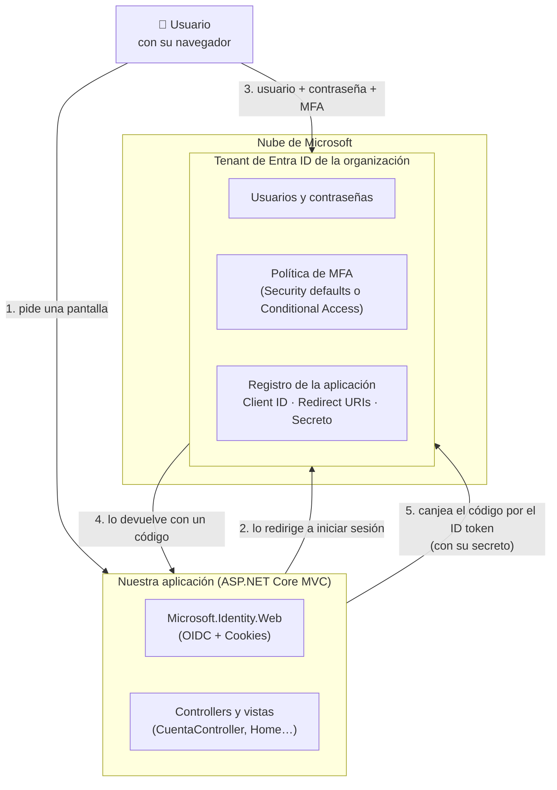
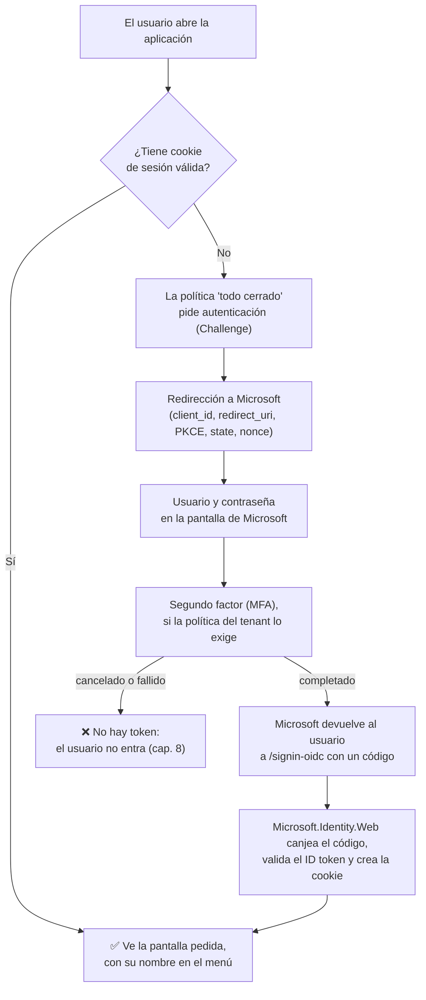

# 1. Introducción y conceptos fundamentales

Antes de configurar nada conviene entender **qué piezas participan** y qué hace cada una. Este capítulo no tiene código: es el mapa mental que vas a usar en el resto de la guía.

## 1.1 Qué es Microsoft Entra ID

**Microsoft Entra ID** (antes llamado *Azure Active Directory* o *Azure AD*) es el **servicio de identidades de Microsoft** en la nube. Guarda las cuentas de una organización (por ejemplo `ana@empresa.com`), sus contraseñas, sus métodos de verificación (como la app Microsoft Authenticator) y las reglas de seguridad que se les aplican.

Una forma simple de pensarlo es un **edificio de oficinas**:

| En el edificio | En nuestro sistema |
|---|---|
| La **recepción** controla tu documento y te entrega una credencial | **Entra ID** verifica tu usuario, contraseña y segundo factor |
| La **credencial** dice quién sos y fue emitida por la recepción | El **token** firmado por Microsoft |
| Cada **oficina** confía en la credencial: no te vuelve a pedir el documento | **Nuestra aplicación** confía en el token: nunca ve tu contraseña |
| La oficina decide **qué podés hacer adentro** | La aplicación decide tus **permisos** (roles de EOP) |

## 1.2 Qué problema resuelve

Sin un servicio de identidad, cada aplicación tendría que guardar contraseñas, protegerlas, permitir recuperarlas, implementar el segundo factor, bloquear intentos sospechosos… Es mucho trabajo y es muy fácil hacerlo mal.

Con Entra ID:

- **La aplicación no guarda contraseñas** (en EOP lo exige el requerimiento RNF-2).
- **El MFA lo resuelve Microsoft** (RNF-3, RF-071).
- La organización administra a sus usuarios **en un solo lugar**: si alguien deja la empresa, se desactiva su cuenta en Entra ID y pierde acceso a todas las aplicaciones conectadas.
- El usuario usa **la misma cuenta** que ya tiene para Outlook, Teams, etc. A esto se le llama *Single Sign-On* (SSO): iniciar sesión una vez y entrar a varias aplicaciones.

## 1.3 Autenticar y autorizar

Son dos preguntas distintas que se responden en momentos distintos:

| Concepto | Pregunta | Quién responde en EOP | Ejemplo |
|---|---|---|---|
| **Autenticación** | ¿Quién sos? | **Entra ID** (y la app confía en su respuesta) | "Sos `ana@empresa.com`, lo comprobó Microsoft con contraseña y MFA" |
| **Autorización** | ¿Qué podés hacer? | **La aplicación** | "Sos Operadora: podés ver proyectos, pero no administrar usuarios" |

**Autenticar** a un usuario significa comprobar su identidad. En nuestro caso no lo hacemos nosotros: lo hace Entra ID, y la aplicación solo recibe el resultado (el token) y verifica que sea auténtico.

> [!EOP]
> La T08 y la T09 resuelven la **autenticación** y una única regla de autorización: *"para ver cualquier pantalla hay que haber iniciado sesión"*. Los permisos por rol (Administrador, Supervisor, Operador) son tareas posteriores.

## 1.4 OAuth 2.0 y OpenID Connect

Para que la aplicación y Entra ID se entiendan necesitan un **protocolo**, es decir, un conjunto de reglas acordadas sobre qué mensajes se mandan y en qué orden.

- **OAuth 2.0** es un estándar para **delegar acceso**: permite que una aplicación obtenga permiso para usar un recurso (por ejemplo, leer tu calendario) sin conocer tu contraseña. Por sí solo **no** dice quién es el usuario.
- **OpenID Connect (OIDC)** es una capa construida **encima de OAuth 2.0** que agrega justamente eso: una forma estándar de **identificar al usuario**. Introduce el **ID token**, un documento firmado que dice quién inició sesión.

> [!NOTA]
> **Nosotros usamos OpenID Connect**, con el flujo llamado *authorization code flow* (flujo de código de autorización) y la protección **PKCE**. Lo explicamos en detalle en el capítulo 4. No necesitás implementar el protocolo a mano: lo hace la librería `Microsoft.Identity.Web`.

## 1.5 Tokens

Un **token** es un texto que funciona como una credencial digital. El que nos interesa es el **ID token**, que tiene formato **JWT** (*JSON Web Token*): tres partes separadas por puntos.

```text
eyJhbGciOiJSUzI1NiIsInR5cCI6IkpXVCJ9 . eyJuYW1lIjoiQW5hIFDDqXJleiIsIm9pZCI6Ij... . SflKxwRJSMeKKF2QT4fwpMeJf36P...
        encabezado                              contenido (claims)                         firma de Microsoft
```

- El **encabezado** dice cómo está firmado.
- El **contenido** tiene los datos del usuario (los *claims*).
- La **firma** la genera Microsoft con su clave privada. La aplicación la verifica con la clave pública de Microsoft. Si alguien cambia una sola letra del contenido, la firma deja de coincidir y el token se rechaza.

> [!ADVERTENCIA]
> El contenido de un JWT **no está cifrado**: cualquiera que tenga el token puede leerlo. Lo que garantiza la firma es que **nadie lo modificó**, no que sea secreto. Por eso los tokens nunca se escriben en logs ni se muestran en pantalla.

Existen otros tokens (el *access token* para llamar APIs y el *refresh token* para renovar). En la T08 y la T09 **no llamamos a ninguna API**, así que solo nos importa el ID token.

## 1.6 Claims

Un **claim** (afirmación) es un dato del usuario dentro del token, con un **tipo** y un **valor**. Así se vería el contenido de un ID token, con datos ficticios:

```json
{
  "aud": "00000000-0000-0000-0000-00000000c11e",
  "iss": "https://login.microsoftonline.com/00000000-0000-0000-0000-00000000aaaa/v2.0",
  "name": "Ana Pérez",
  "preferred_username": "ana@empresa.com",
  "oid": "11111111-2222-3333-4444-555555555555",
  "tid": "00000000-0000-0000-0000-00000000aaaa",
  "nonce": "638...",
  "exp": 1793000000
}
```

| Claim | Qué significa | Dónde se usa |
|---|---|---|
| `name` | Nombre para mostrar | EOP lo muestra en la barra superior (T09) |
| `preferred_username` | Nombre de usuario, normalmente el correo | Respaldo si no viene `name` |
| `oid` | Identificador **fijo** de la persona dentro del tenant | La T10 lo va a guardar en `Usuario.EntraObjectId` |
| `tid` | Identificador del tenant (la organización) | Verificación interna de la librería |
| `aud` | Para qué aplicación se emitió (nuestro Client ID) | Verificación interna de la librería |
| `iss` | Quién lo emitió | Verificación interna de la librería |
| `exp` | Hasta cuándo es válido | Verificación interna de la librería |
| `nonce` | Valor de un solo uso que la app mandó al pedir el login | Evita que reutilicen un token viejo |

En ASP.NET Core, los claims del usuario autenticado quedan disponibles en `User` (dentro de un Controller o una vista). Por ejemplo: `User.FindFirst("name")?.Value`.

> [!PENDIENTE]
> Cómo vincular el `oid` con el usuario registrado en EOP es tema de la **T10**. Esta guía todavía no lo documenta como implementado.

## 1.7 Cookies

HTTP, el protocolo de la web, es **sin estado**: cada clic es una petición nueva y el servidor no recuerda nada de la anterior. Si no hubiera un mecanismo extra, tendrías que pasar por Microsoft en **cada** clic.

Una **cookie** es un pequeño dato que el servidor le pide al navegador que guarde y que el navegador **devuelve automáticamente** en cada petición a ese mismo sitio. Es como la pulsera de un festival: mostrás la entrada una vez y después te movés mostrando la pulsera.

Después de que Entra ID confirma quién sos, la aplicación crea una **cookie de autenticación**. Ahí guarda tus claims, **cifrados y firmados** por la propia aplicación. Mientras esa cookie sea válida, **tenés sesión**. Una **sesión** es justamente ese período en que el servidor reconoce que las peticiones vienen de la misma persona ya autenticada.

En una aplicación como EOP intervienen varias cookies:

| Cookie | Quién la crea | Para qué |
|---|---|---|
| `.AspNetCore.Cookies` (puede dividirse en `...C1`, `...C2`) | La app, al terminar el login | **Es la sesión**: guarda quién sos |
| `.AspNetCore.Correlation.*` | La app, al mandarte a Microsoft | Verificar que el login que vuelve lo empezó esta app |
| `.AspNetCore.OpenIdConnect.Nonce.*` | La app, al mandarte a Microsoft | Verificar el `nonce` del token |
| `.AspNetCore.Antiforgery.*` | La app, al mostrar un formulario | Protección contra CSRF (capítulo 7) |
| Cookies de `login.microsoftonline.com` | Microsoft | La sesión de Microsoft (SSO). Es **distinta** de la nuestra |

## 1.8 Qué hace Microsoft.Identity.Web

`Microsoft.Identity.Web` es la **librería oficial de Microsoft** para conectar aplicaciones ASP.NET Core con Entra ID. Se instala como paquete NuGet y, con una línea de configuración, se encarga de:

- Registrar los dos "esquemas" de autenticación que necesitamos: **OpenID Connect** (hablar con Microsoft) y **Cookies** (recordar al usuario).
- Leer la configuración (`TenantId`, `ClientId`, secreto) desde `appsettings.json` y User Secrets.
- Armar la redirección a Microsoft con todos los parámetros de seguridad.
- Recibir la respuesta en `/signin-oidc`, canjear el código, **validar el token** (firma, emisor, audiencia, vencimiento, nonce) y crear la cookie.
- Atender el regreso del cierre de sesión en `/signout-callback-oidc`.

> [!EOP]
> EOP usa `Microsoft.Identity.Web` **versión 4.16.1** (archivo `src/EOP.Gestion.WebApp/EOP.Gestion.WebApp.csproj`). No usa el paquete complementario `Microsoft.Identity.Web.UI`, que trae pantallas de login/logout en inglés: las pantallas y acciones las escribimos nosotros (`CuentaController`).

## 1.9 MFA: qué es y quién lo administra

**MFA** (*Multi-Factor Authentication*, autenticación multifactor) significa pedir **más de una prueba** de identidad. Normalmente:

1. Algo que **sabés**: la contraseña.
2. Algo que **tenés**: el celular con Microsoft Authenticator, que muestra una notificación o un código.

Lo importante para el desarrollador es que **el MFA lo administra Entra ID, no la aplicación**:

- La aplicación **no** muestra la pantalla del segundo factor ni guarda códigos (RF-071).
- **Quién debe hacer MFA y cuándo** lo decide la organización en su tenant: con los *Security defaults* (valores de seguridad predeterminados, gratuitos) o con políticas de *Conditional Access* (acceso condicional, requieren licencia Entra ID P1). Lo vemos en el capítulo 3.
- Si el usuario no completa el MFA, Microsoft **no emite el token**, así que la aplicación nunca lo deja pasar.

> [!PENDIENTE]
> Verificar desde la aplicación que el usuario efectivamente completó MFA es parte de la **T11** ("Implementar restricciones de acceso"). Hoy EOP confía en la política de MFA del tenant.

## 1.10 Cómo se relacionan Azure, Entra ID y nuestra aplicación

**Azure** es la plataforma de nube de Microsoft (servidores, bases de datos, almacenamiento…). **Entra ID** es el servicio de identidades que usan Azure, Microsoft 365 y cualquier aplicación que conectemos. Toda organización con Azure o Microsoft 365 tiene un **tenant** de Entra ID: su "directorio" de usuarios.

Para que nuestra aplicación pueda usar ese directorio, hay que darla de alta en él. Eso se llama **registro de aplicación** (*App registration*) y es lo que hacemos en el capítulo 3.



## 1.11 El circuito completo, de un vistazo

Este es el recorrido desde que alguien abre la aplicación hasta que la usa autenticado. Cada paso se explica en detalle en los capítulos siguientes.



> [!NOTA]
> En la vida real todo esto dura un par de segundos: el usuario solo ve la pantalla de Microsoft y después la aplicación.
