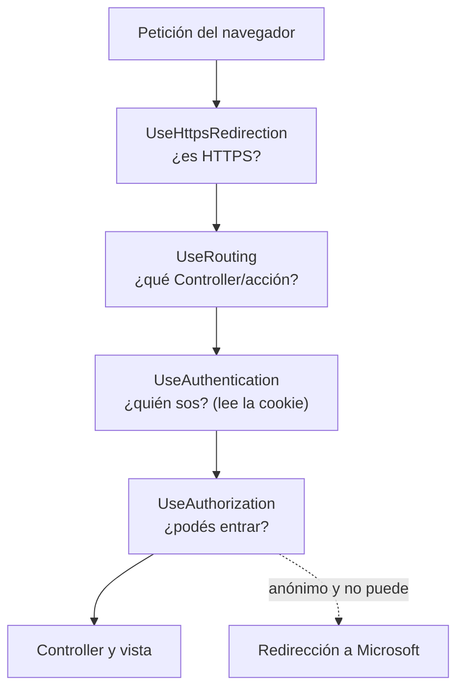
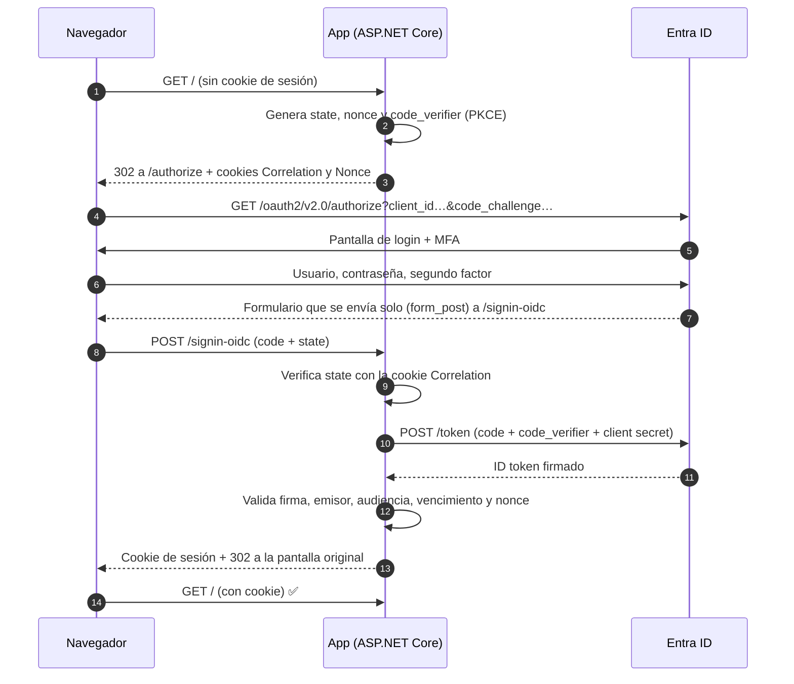

# 4. Integración con ASP.NET Core MVC (S1-T08)

Con la aplicación registrada en Entra ID, ahora conectamos el proyecto. Al final del capítulo vas a poder iniciar sesión con tu cuenta de Microsoft por primera vez.

**Qué vamos a tocar**

| Archivo | Cambio |
|---|---|
| `*.csproj` del proyecto web | Paquete `Microsoft.Identity.Web` y `UserSecretsId` |
| `appsettings.json` | Sección `AzureAd` (datos **no** secretos) |
| User Secrets (fuera del repositorio) | El client secret |
| `Program.cs` | Registrar la autenticación y los middlewares |

## 4.1 Crear el proyecto (solo para un proyecto nuevo)

> [!GENERAL]
> **Con Visual Studio**
> 1. **File** › **New** › **Project**.
> 2. Elegí la plantilla **ASP.NET Core Web App (Model-View-Controller)** y **Next**.
> 3. Escribí el nombre y la ubicación, y **Next**.
> 4. En **Framework** elegí la versión de .NET (por ejemplo **.NET 10.0**).
> 5. En **Authentication type** elegí **None**.
> 6. Dejá marcado **Configure for HTTPS**.
> 7. **Create**.
>
> **Con la terminal**: `dotnet new mvc -n MiAplicacion` (HTTPS viene activado por defecto).

**¿Por qué "Authentication type: None"?** La plantilla tiene una opción *Microsoft identity platform* que genera todo automáticamente. Funciona, pero esconde las decisiones y agrega pantallas en inglés. En esta guía lo hacemos a mano para entender cada pieza, que es lo que vas a necesitar para defenderlo y mantenerlo.

> [!EOP]
> En EOP la solución tiene tres proyectos (`Core`, `Infrastructure`, `WebApp`) más el de pruebas. **Todo lo de autenticación está en `EOP.Gestion.WebApp`**, que es la capa de presentación. Ni `Core` ni `Infrastructure` saben que existe Entra ID.

## 4.2 Instalar Microsoft.Identity.Web

**Con Visual Studio**

1. En el **Solution Explorer**, clic derecho sobre el proyecto web › **Manage NuGet Packages…**
2. Pestaña **Browse**: buscá `Microsoft.Identity.Web`.
3. Elegí el paquete publicado por **Microsoft**, seleccioná la versión y elegí **Install**.
4. Aceptá las licencias si aparece el diálogo.

**Con la terminal** (desde la carpeta del proyecto web):

```bash
dotnet add package Microsoft.Identity.Web --version 4.16.1
```

El `.csproj` queda con una línea nueva:

```xml
<ItemGroup>
  <PackageReference Include="Microsoft.Identity.Web" Version="4.16.1" />
</ItemGroup>
```

> [!EOP]
> Es exactamente la línea que agregó la T08 en `src/EOP.Gestion.WebApp/EOP.Gestion.WebApp.csproj`. En el mismo PR (#10) se actualizó además una dependencia del proyecto de pruebas (`System.Security.Cryptography.Xml 10.0.14`) porque NuGet la marcaba como vulnerable.

> [!PRUEBA]
> `dotnet build` termina sin errores.

## 4.3 Configurar appsettings.json

Agregá la sección `AzureAd` con los datos **no secretos** que copiaste del portal:

```json
{
  "AzureAd": {
    "Instance": "https://login.microsoftonline.com/",
    "TenantId": "<TENANT-ID>",
    "ClientId": "<CLIENT-ID>",
    "CallbackPath": "/signin-oidc"
  },
  "Logging": {
    "LogLevel": {
      "Default": "Information",
      "Microsoft.AspNetCore": "Warning"
    }
  },
  "AllowedHosts": "*"
}
```

| Clave | Qué significa |
|---|---|
| `Instance` | La dirección base del servicio de login de Microsoft (nube pública) |
| `TenantId` | Qué directorio acepta los inicios de sesión. Con un GUID concreto, solo ese tenant (*single tenant*) |
| `ClientId` | Qué aplicación está pidiendo el login |
| `CallbackPath` | La ruta de **tu** app a la que vuelve Microsoft. Tiene que coincidir con la Redirect URI registrada |

> [!EOP]
> `src/EOP.Gestion.WebApp/appsettings.json` tiene exactamente esas cuatro claves, con el tenant y el client ID reales de EOP. **No** tiene el secreto.

> [!ADVERTENCIA]
> **Nunca** agregues `ClientSecret` en `appsettings.json`: ese archivo se sube a GitHub. AGENTS.md (RNF-2 / RNF-11) lo prohíbe de forma explícita.

## 4.4 Guardar el secreto con User Secrets

**User Secrets** es un mecanismo de .NET para guardar configuración sensible **fuera de la carpeta del proyecto**, en tu perfil de Windows. Así el secreto no puede terminar en un commit por accidente.

- Se guarda en `%APPDATA%\Microsoft\UserSecrets\<UserSecretsId>\secrets.json`.
- `WebApplication.CreateBuilder` lo carga **solo cuando el entorno es `Development`**.
- Cada integrante del equipo carga **sus propios** valores en su máquina.

### Con Visual Studio

1. Clic derecho sobre el proyecto web › **Manage User Secrets**.
2. Se abre `secrets.json`. Si es la primera vez, Visual Studio agrega también un `UserSecretsId` al `.csproj`.
3. Escribí:

```json
{
  "AzureAd": {
    "ClientCredentials": [
      {
        "SourceType": "ClientSecret",
        "ClientSecret": "<CLIENT-SECRET>"
      }
    ]
  }
}
```

### Con la terminal

```bash
dotnet user-secrets init
dotnet user-secrets set "AzureAd:ClientCredentials:0:SourceType" "ClientSecret"
dotnet user-secrets set "AzureAd:ClientCredentials:0:ClientSecret" "<CLIENT-SECRET>"
```

**¿Por qué esa forma rara (`ClientCredentials:0:...`)?** `Microsoft.Identity.Web` admite una **lista** de credenciales (secreto, certificado, Key Vault…). El `0` es la primera posición de esa lista, y `SourceType` le dice de qué tipo es. Los `:` son la forma de .NET de escribir "una sección dentro de otra" en una sola línea.

> [!EOP]
> El `.csproj` de EOP define `<UserSecretsId>eop-gestion-webapp-7c3e9a41-2f6d-4b8e-9d15-a0c4e6b28f73</UserSecretsId>`, con un comentario aclarando que **no es un secreto**: es solo el nombre de la carpeta donde cada integrante guarda sus valores. En las máquinas de desarrollo están cargadas estas claves (los valores no se muestran):
>
> - `AzureAd:ClientCredentials:0:SourceType`
> - `AzureAd:ClientCredentials:0:ClientSecret`
> - `ConnectionStrings:EopDb` (la base de datos, de la T06; no tiene que ver con Entra ID)

> [!PRUEBA]
> `dotnet user-secrets list` muestra las claves. **Ojo: también muestra los valores**, así que no lo hagas compartiendo pantalla.

> [!GENERAL] ¿Y en producción?
> User Secrets **no existe** en el servidor. En Azure App Service el secreto se carga en **Configuration** (o *Environment variables*) como variable de entorno, reemplazando cada `:` por **dos guiones bajos**: `AzureAd__ClientCredentials__0__ClientSecret`. Mejor todavía: usar un certificado en **Azure Key Vault** (capítulo 3.6). EOP aún no tiene esto configurado.

## 4.5 Configurar Program.cs

Este es el `Program.cs` mínimo para tener autenticación con Entra ID. Es la versión **sin los comentarios largos** de lo que hizo la T08 en EOP:

```csharp
using Microsoft.AspNetCore.Authentication.OpenIdConnect;
using Microsoft.Identity.Web;

var builder = WebApplication.CreateBuilder(args);

builder.Services.AddControllersWithViews();

// 1. Autenticación con Microsoft Entra ID.
builder.Services
    .AddAuthentication(OpenIdConnectDefaults.AuthenticationScheme)
    .AddMicrosoftIdentityWebApp(builder.Configuration.GetSection("AzureAd"));

// 2. Ajustes del protocolo: flujo de código + PKCE.
builder.Services.PostConfigure<OpenIdConnectOptions>(
    OpenIdConnectDefaults.AuthenticationScheme,
    options =>
    {
        options.ResponseType = "code";
        options.UsePkce = true;
    });

var app = builder.Build();

if (!app.Environment.IsDevelopment())
{
    app.UseExceptionHandler("/Home/Error");
    app.UseHsts();
}

app.UseHttpsRedirection();
app.UseRouting();

// 3. Middlewares: primero quién sos, después si podés.
app.UseAuthentication();
app.UseAuthorization();

app.MapStaticAssets();
app.MapControllerRoute(
    name: "default",
    pattern: "{controller=Home}/{action=Index}/{id?}")
    .WithStaticAssets();

app.Run();
```

> [!EOP]
> En `src/EOP.Gestion.WebApp/Program.cs` además hay una línea `builder.Services.AgregarInfraestructura(builder.Configuration);`, que registra la base de datos (no tiene que ver con Entra ID), y muchos comentarios explicativos. La T09 agregó más cosas a este archivo (capítulos 5 a 8).

### Qué hace cada parte

**`AddAuthentication(OpenIdConnectDefaults.AuthenticationScheme)`** registra el sistema de autenticación de ASP.NET Core e indica cuál es el **esquema por defecto**. `OpenIdConnectDefaults.AuthenticationScheme` es simplemente el texto `"OpenIdConnect"`.

**`AddMicrosoftIdentityWebApp(...)`** es la línea más importante. Lee la sección `AzureAd` (de `appsettings.json` **y** de User Secrets, porque .NET junta las dos fuentes) y registra **dos esquemas** que trabajan juntos:

| Esquema | Nombre | Responsabilidad |
|---|---|---|
| OpenID Connect | `"OpenIdConnect"` | Hablar con Entra ID: redirigir al login, recibir la respuesta en `/signin-oidc`, canjear el código y validar el token |
| Cookies | `"Cookies"` | Recordar al usuario: crear la cookie de sesión y leerla en cada petición siguiente |

Un **esquema de autenticación** es un "especialista" con nombre al que ASP.NET Core le delega una tarea. Microsoft.Identity.Web deja la configuración armada para que ASP.NET Core use **Cookies** para leer y guardar la sesión, y **OpenIdConnect** cuando hay que pedirle al usuario que se identifique.

**`PostConfigure<OpenIdConnectOptions>(...)`** ajusta las opciones del esquema OpenID Connect **después** de que Microsoft.Identity.Web las configuró. Por eso nuestros valores prevalecen.

- `ResponseType = "code"`: pedimos el **flujo de código de autorización** (sección 4.7).
- `UsePkce = true`: activamos **PKCE** (sección 4.7).

Dejarlos escritos de forma explícita documenta la decisión de seguridad y evita depender de valores por defecto que podrían cambiar entre versiones.

**`UseAuthentication()`** agrega el middleware que, en **cada** petición, le pide al esquema Cookies que lea la cookie. Si es válida, carga la identidad del usuario en `HttpContext.User`. También atiende las rutas especiales `/signin-oidc` y `/signout-callback-oidc`.

**`UseAuthorization()`** agrega el middleware que decide si el usuario (ya identificado o anónimo) puede acceder a la pantalla pedida. Si no puede y es anónimo, dispara el **Challenge**: la redirección a Microsoft.

## 4.6 Por qué importa el orden de los middlewares

Un **middleware** es un eslabón de la cadena por la que pasa cada petición. Se ejecutan **en el orden en que los escribís** en `Program.cs`.



- `UseRouting` va **antes** de los otros dos, porque la autorización necesita saber **qué** pantalla se pidió para ver qué reglas tiene.
- `UseAuthentication` va **antes** de `UseAuthorization`, porque no se puede decidir si alguien puede entrar sin saber primero quién es.

> [!ADVERTENCIA]
> Si invertís `UseAuthentication` y `UseAuthorization`, la autorización siempre ve un usuario **anónimo**: después de loguearte, la app te vuelve a mandar a Microsoft una y otra vez (un bucle de redirecciones).

## 4.7 Cómo funciona el flujo de OpenID Connect por dentro

Este es el detalle de lo que pasa cuando alguien sin sesión pide una pantalla protegida. Los parámetros son los **reales** que manda EOP (capturados con la app corriendo; los valores secretos o aleatorios se reemplazaron).



El pedido que arma la aplicación (paso 3) se ve así:

```text
https://login.microsoftonline.com/<TENANT-ID>/oauth2/v2.0/authorize
  ?client_id=<CLIENT-ID>
  &redirect_uri=https%3A%2F%2Flocalhost%3A7125%2Fsignin-oidc
  &response_type=code
  &scope=openid%20profile
  &code_challenge=<valor generado>
  &code_challenge_method=S256
  &response_mode=form_post
  &nonce=<valor generado>
  &state=<valor generado>
  &x-client-SKU=ID_NET10_0
```

| Parámetro | Para qué sirve |
|---|---|
| `client_id` | Qué aplicación pide el login |
| `redirect_uri` | A dónde volver. Tiene que estar registrada (si no: AADSTS50011) |
| `response_type=code` | "Devolveme un **código**, no el token directamente" |
| `scope=openid profile` | "Quiero identificar al usuario (`openid`) y saber su nombre (`profile`)" |
| `code_challenge` + `S256` | La parte pública de **PKCE** |
| `response_mode=form_post` | La respuesta vuelve como un **formulario POST** y no en la dirección, que es más seguro y no tiene límite de largo |
| `nonce` | Valor de un solo uso que tiene que volver **dentro** del token (evita reutilizar tokens viejos) |
| `state` | Valor de un solo uso que tiene que volver **junto** con la respuesta (evita respuestas que no pedimos) |

**El flujo de código, con una analogía.** En vez de entregarte el carnet (token) en la mano a la salida de la recepción, donde alguien podría verlo, Microsoft te da un **número de retiro** (el código). Tu aplicación va por la puerta de atrás (servidor a servidor), muestra el número **y su firma autorizada** (el client secret), y recién ahí recibe el carnet.

**PKCE** (*Proof Key for Code Exchange*) agrega un candado más. Antes de mandarte a Microsoft, la aplicación inventa una clave secreta (`code_verifier`) y manda solo su "huella" (`code_challenge`). Al canjear el código tiene que mostrar la clave original. Si alguien robó el código en el camino, no tiene la clave y el canje falla.

**Las cookies temporales del login.** En el paso 3 la aplicación deja dos cookies que solo se usan en `/signin-oidc`:

```text
Set-Cookie: .AspNetCore.OpenIdConnect.Nonce.CfDJ8…=N; path=/signin-oidc; secure; samesite=none; httponly
Set-Cookie: .AspNetCore.Correlation.UZDHx…=N;        path=/signin-oidc; secure; samesite=none; httponly
```

Tienen `samesite=none` porque la respuesta llega como un POST **desde otro sitio** (`login.microsoftonline.com`). Con otro valor, el navegador no las mandaría y el login fallaría con *Correlation failed* (capítulo 10).

## 4.8 Probar la primera autenticación

Con lo anterior, la app ya **sabe** iniciar sesión, pero ninguna pantalla lo **exige**. Para la primera prueba, protegé una sola acción de forma temporal:

> [!RECONSTRUIDO]
> El PR #10 dice que el login se probó con éxito y que el "código temporal de prueba" se retiró antes del merge, pero no conserva ese código. Esta es una forma equivalente de hacer la prueba.

```csharp
using Microsoft.AspNetCore.Authorization;

public class HomeController : Controller
{
    [Authorize] // TEMPORAL: solo para probar el primer login.
    public IActionResult Index()
    {
        ViewData["Usuario"] = User.Identity?.Name; // TEMPORAL
        return View();
    }
}
```

1. Elegí el perfil **https** en Visual Studio y ejecutá con <kbd>F5</kbd>.
2. El navegador tiene que **salir de tu app** e ir a `login.microsoftonline.com`.


3. Iniciá sesión con tu cuenta y completá el MFA.
4. Puede aparecer una pantalla de **consentimiento** ("Permisos solicitados"). Si sos vos el usuario de prueba, aceptá.
5. Tenés que volver a tu aplicación, a `https://localhost:<PUERTO>/`.
6. Si mostrás `ViewData["Usuario"]` en la vista, vas a ver tu usuario.

> [!PRUEBA]
> - En las herramientas de desarrollo del navegador (<kbd>F12</kbd> › **Application** › **Cookies**) aparece `.AspNetCore.Cookies` para `https://localhost:<PUERTO>`.
> - Si cerrás y volvés a abrir la pestaña (sin cerrar el navegador), no te vuelve a pedir login.

> [!ADVERTENCIA]
> **Sacá** el `[Authorize]` y el código temporal cuando termine la prueba. En el capítulo 6 protegemos todo de forma definitiva con otra técnica.

Si algo falla en esta prueba, buscá el mensaje en el **capítulo 10**. Los más comunes en este punto son AADSTS50011 (Redirect URI), AADSTS7000215 (secreto incorrecto) y AADSTS700016 (Client ID o tenant equivocado).
