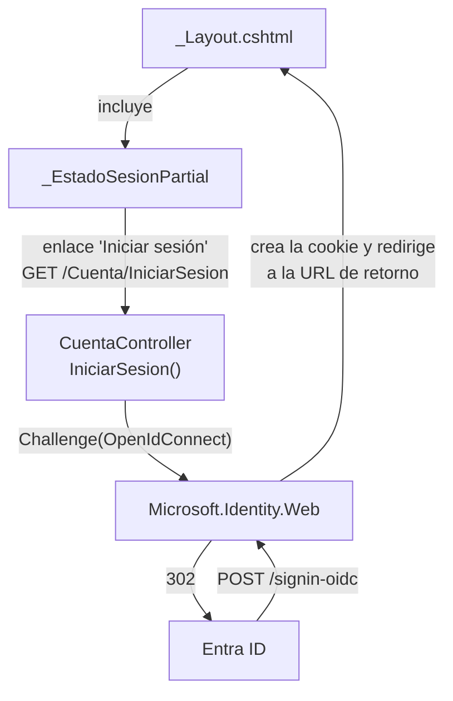

# 5. Implementación del inicio de sesión (S1-T09)

En el capítulo 4 probamos el login con un `[Authorize]` temporal. Ahora construimos el circuito definitivo: una acción **Iniciar sesión**, un enlace en el menú y el nombre del usuario cuando ya entró.

## 5.1 Las piezas y cómo se comunican

| Pieza | Tipo | Responsabilidad |
|---|---|---|
| `CuentaController` | Controller MVC | Recibir los pedidos de "iniciar sesión" (y "cerrar sesión", capítulo 7) y traducirlos en órdenes para ASP.NET Core |
| `IniciarSesion` | Acción de `CuentaController` | Validar a dónde volver y disparar el **Challenge** hacia Entra ID |
| Microsoft.Identity.Web | Librería | Todo el protocolo: redirigir, recibir `/signin-oidc`, validar el token, crear la cookie |
| `_EstadoSesionPartial.cshtml` | Vista parcial | Mostrar "Iniciar sesión" o el nombre del usuario en la barra superior |
| `_Layout.cshtml` | Layout | Incluir la vista parcial en todas las páginas |



> [!NOTA]
> Un Controller **no** contiene reglas de negocio (AGENTS.md). `CuentaController` solo coordina: valida un parámetro y le pide a ASP.NET Core que inicie el login. Todo el trabajo pesado lo hace la librería.

## 5.2 Paso 1 — Crear CuentaController con la acción IniciarSesion

Creá `Controllers/CuentaController.cs`. Esta es la acción tal cual está en EOP:

```csharp
using Microsoft.AspNetCore.Authentication;
using Microsoft.AspNetCore.Authentication.OpenIdConnect;
using Microsoft.AspNetCore.Authorization;
using Microsoft.AspNetCore.Mvc;

namespace EOP.Gestion.WebApp.Controllers
{
    public class CuentaController : Controller
    {
        // GET /Cuenta/IniciarSesion?urlRetorno=/Home/Index
        [HttpGet]
        [AllowAnonymous]
        public IActionResult IniciarSesion(string? urlRetorno = null)
        {
            // Solo aceptamos volver a direcciones de nuestra propia app.
            var destino = Url.IsLocalUrl(urlRetorno) ? urlRetorno! : Url.Content("~/");

            // Si ya tiene sesión, no lo mandamos a Microsoft otra vez.
            if (User.Identity?.IsAuthenticated == true)
            {
                return LocalRedirect(destino);
            }

            // "Identificate con Entra ID" y, al terminar, volvé a 'destino'.
            var propiedades = new AuthenticationProperties { RedirectUri = destino };

            return Challenge(propiedades, OpenIdConnectDefaults.AuthenticationScheme);
        }
    }
}
```

> [!EOP]
> Archivo: `src/EOP.Gestion.WebApp/Controllers/CuentaController.cs`. En el repositorio el método tiene además comentarios largos, en tono didáctico, que explican cada línea.

### Línea por línea

**`[HttpGet]`**: la acción responde a pedidos GET, o sea, a un enlace común. Iniciar sesión no modifica datos, así que GET es correcto.

**`[AllowAnonymous]`**: la puede usar alguien **sin sesión**. Es imprescindible: quien toca "Iniciar sesión" todavía no inició sesión. En el capítulo 6 vas a ver que, sin este atributo, la política "todo cerrado" bloquearía la acción.

**`string? urlRetorno`**: a qué pantalla volver después del login. Llega por la dirección: `/Cuenta/IniciarSesion?urlRetorno=/Home/Privacy`.

**`Url.IsLocalUrl(urlRetorno)`** devuelve `true` solo si la dirección es **de nuestra aplicación** (empieza con `/` y no con `//` ni con `http…`). Si no, usamos el inicio de la app.

**`Url.Content("~/")`** arma la dirección del inicio de la aplicación. Normalmente es `/`, pero si algún día la app se publica dentro de una subcarpeta, devuelve la ruta correcta.

**`User.Identity?.IsAuthenticated == true`**: `User` es el usuario de la petición actual, cargado por `UseAuthentication()` a partir de la cookie. Si ya está autenticado, no tiene sentido mandarlo a Microsoft.

**`LocalRedirect(destino)`** redirige, pero **vuelve a comprobar** que la dirección sea local. Si no lo es, lanza una excepción en lugar de redirigir a un sitio externo. Es una segunda barrera.

**`Challenge(propiedades, OpenIdConnectDefaults.AuthenticationScheme)`** es el corazón del login. *Challenge* significa "desafío: identificate". Le dice a ASP.NET Core: "usá el esquema **OpenIdConnect** para pedirle al usuario que se identifique". El resultado es la redirección 302 a Microsoft que viste en el capítulo 4.

**`AuthenticationProperties.RedirectUri`**: a dónde ir **cuando todo termine bien**. Microsoft.Identity.Web la guarda (protegida dentro del `state`), y después de procesar `/signin-oidc` redirige ahí.

## 5.3 Qué pasa entre el Challenge y el regreso

1. `Challenge` devuelve un **302** a `login.microsoftonline.com` con los parámetros de la sección 4.7, y deja las cookies temporales *Correlation* y *Nonce*.
2. El usuario se autentica en Microsoft (contraseña y MFA).
3. Microsoft devuelve un formulario que el navegador envía solo, por POST, a **`/signin-oidc`**.
4. El middleware de autenticación (`UseAuthentication`) atiende esa ruta. **No hay ningún Controller tuyo en `/signin-oidc`**.
5. La librería verifica el `state`, canjea el código por el ID token (con PKCE y el client secret), valida el token y arma un `ClaimsPrincipal` con los claims.
6. El esquema **Cookies** guarda ese `ClaimsPrincipal` cifrado en la cookie **`.AspNetCore.Cookies`**.
7. Redirige a `RedirectUri` (por ejemplo `/Home/Privacy`).
8. En el siguiente pedido, `UseAuthentication()` lee la cookie y `User.Identity.IsAuthenticated` vale `true`.

> [!NOTA] ¿Qué guarda la cookie?
> Los claims del usuario (nombre, `oid`, etc.), **cifrados y firmados** con las claves de *Data Protection* de ASP.NET Core. El usuario no puede leerla ni modificarla. **No** guarda la contraseña: la aplicación nunca la tuvo.

## 5.4 Paso 2 — El enlace "Iniciar sesión" y el nombre del usuario

Creá `Views/Shared/_EstadoSesionPartial.cshtml`. Una **vista parcial** es un pedazo de vista reutilizable, que se incluye dentro de otras. Esta es la de EOP, con los comentarios resumidos:

```cshtml
@if (User.Identity?.IsAuthenticated == true)
{
    // "name" es el nombre completo que manda Microsoft en el token.
    var nombreVisible = User.FindFirst("name")?.Value ?? User.Identity.Name;

    <ul class="navbar-nav">
        <li class="nav-item">
            <span class="navbar-text text-dark">@nombreVisible</span>
        </li>
        <li class="nav-item">
            <form asp-controller="Cuenta" asp-action="CerrarSesion" method="post" class="d-inline">
                <button type="submit" class="nav-link btn btn-link text-dark">Cerrar sesión</button>
            </form>
        </li>
    </ul>
}
else
{
    <ul class="navbar-nav">
        <li class="nav-item">
            <a class="nav-link text-dark" asp-controller="Cuenta" asp-action="IniciarSesion">Iniciar sesión</a>
        </li>
    </ul>
}
```

Y en `Views/Shared/_Layout.cshtml`, dentro de la barra de navegación y después de la lista de enlaces, agregá **una línea**:

```cshtml
<partial name="_EstadoSesionPartial" />
```

**Detalles importantes**

- `User.FindFirst("name")?.Value` busca el claim `name`. Si no viene, se usa `User.Identity.Name` (el nombre de usuario, normalmente el correo).
- `@nombreVisible`: Razor **escapa** el texto al mostrarlo. Si un nombre trajera algo como `<script>`, se mostraría como texto y no se ejecutaría.
- `asp-controller` y `asp-action` son *tag helpers*: generan la dirección correcta (`/Cuenta/IniciarSesion`) aunque cambien las rutas.
- El botón "Cerrar sesión" es un **formulario POST** y no un enlace. Se explica en el capítulo 7.

> [!ADVERTENCIA]
> Esta vista **solo muestra** cosas. Esconder un botón **no es** control de acceso (RNF-4). Lo que realmente protege las pantallas es la política del capítulo 6, que se evalúa en el servidor.

## 5.5 Validación de la URL de retorno: el ataque de open redirect

Imaginá que alguien te manda este enlace por correo:

```text
https://eop.empresa.com/Cuenta/IniciarSesion?urlRetorno=https://eop-empresa.com.sitio-falso.net/login
```

El enlace empieza con el dominio **real**, así que parece confiable. Si la aplicación redirigiera sin controlar `urlRetorno`, después del login real te mandaría a una copia falsa que podría pedirte la contraseña "otra vez". A ese ataque se le llama **open redirect** (redirección abierta).

| `urlRetorno` | ¿`Url.IsLocalUrl`? | Resultado en EOP |
|---|---|---|
| `/Home/Privacy` | Sí | Vuelve a `/Home/Privacy` |
| `https://sitio-falso.com` | No | Vuelve al inicio `/` |
| `//sitio-falso.com` | No (las dos barras indican otro dominio) | Vuelve al inicio `/` |
| *(vacío)* | No | Vuelve al inicio `/` |

> [!EOP]
> Estos cuatro casos están cubiertos por pruebas automáticas en `CuentaControllerTests` (capítulo 9).

## 5.6 Dos caminos al login

En EOP hay **dos formas** de terminar en la pantalla de Microsoft, y es importante distinguirlas:

| Camino | Cuándo pasa | Quién dispara el Challenge |
|---|---|---|
| **Automático** | Alguien sin sesión pide cualquier pantalla protegida (por ejemplo `/`) | El middleware de autorización, por la política del capítulo 6. Vuelve a la pantalla pedida |
| **Explícito** | Alguien toca el enlace **Iniciar sesión** (por ejemplo, desde "Sesión cerrada") | `CuentaController.IniciarSesion` |

## 5.7 Si el usuario ya está autenticado

Si alguien con sesión abre `/Cuenta/IniciarSesion?urlRetorno=/Home/Privacy`, la acción **no** lo manda a Microsoft: devuelve `LocalRedirect("/Home/Privacy")`. Así se evita un viaje innecesario y un posible pedido de MFA repetido.

## 5.8 Si la autenticación queda incompleta

Si el usuario cancela, no completa el MFA o Microsoft rechaza el login:

- **Microsoft no emite el token**, así que nunca se crea la cookie: el usuario **no entra**.
- A veces Microsoft muestra su propia página de error y no vuelve a la aplicación.
- Otras veces vuelve a `/signin-oidc` con un error. En ese caso EOP lo registra y muestra una pantalla propia, **"No se pudo iniciar sesión"** (capítulo 8).

> [!PRUEBA]
> 1. Con el perfil **https**, abrí la app en una ventana privada: tenés que terminar en Microsoft.
> 2. Iniciá sesión: tenés que volver con **tu nombre** arriba a la derecha.
> 3. Abrí `https://localhost:<PUERTO>/Cuenta/IniciarSesion?urlRetorno=https://www.google.com`. Con sesión, tenés que quedar en el inicio de **tu** app, nunca en Google.
