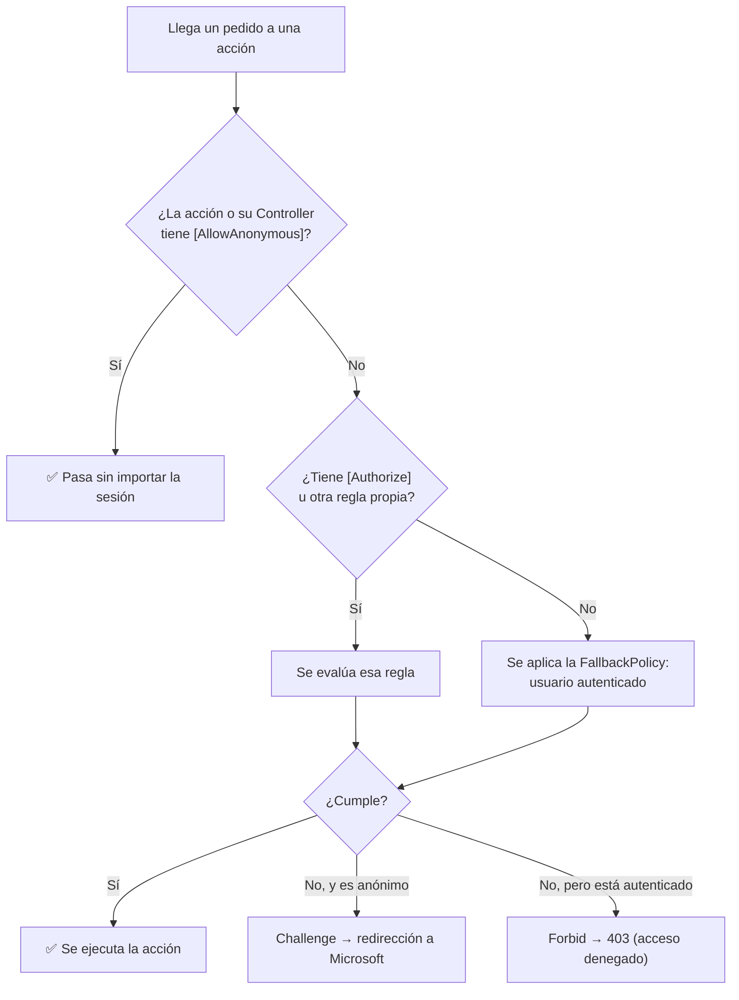

# 6. Protección de páginas y autorización (S1-T09)

Saber iniciar sesión no alcanza: la aplicación tiene que **exigirlo**. En este capítulo vemos las herramientas de ASP.NET Core para proteger pantallas y la estrategia que usa EOP: **todo cerrado por defecto**.

## 6.1 [Authorize]

`[Authorize]` es un **atributo** (una etiqueta que se pone arriba de una clase o un método) que significa "para entrar acá hay que estar autenticado".

```csharp
[Authorize]                       // aplica a todas las acciones del Controller
public class ProyectosController : Controller
{
    public IActionResult Index() => View();
}
```

Si alguien sin sesión pide `/Proyectos`, ASP.NET Core dispara el **Challenge** y lo manda a Microsoft.

Más adelante se puede usar con requisitos extra, por ejemplo `[Authorize(Roles = "Administrador")]`.

> [!PENDIENTE]
> Los permisos por rol (Administrador, Supervisor, Operador) corresponden a la **T12/T13** (US-044). Hoy EOP no usa `[Authorize(Roles = …)]` en ningún lado.

## 6.2 [AllowAnonymous]

`[AllowAnonymous]` hace lo contrario: "acá puede entrar **cualquiera**, aunque no tenga sesión". Tiene prioridad sobre las demás reglas.

```csharp
[AllowAnonymous]
public IActionResult SesionCerrada() => View();
```

## 6.3 FallbackPolicy: todo cerrado por defecto

Podríamos poner `[Authorize]` en cada Controller, pero tiene un problema: **si alguien se olvida**, esa pantalla queda pública sin que nadie lo note.

La alternativa es la **política de respaldo** (*FallbackPolicy*): la regla que ASP.NET Core aplica a **toda pantalla que no diga nada** sobre autorización. EOP la configura así en `Program.cs`:

```csharp
using Microsoft.AspNetCore.Authorization;

builder.Services.AddAuthorization(options =>
{
    options.FallbackPolicy = new AuthorizationPolicyBuilder()
        .RequireAuthenticatedUser()
        .Build();
});
```

- `AuthorizationPolicyBuilder` arma una **política**, que es un conjunto de requisitos.
- `RequireAuthenticatedUser()` agrega el requisito "usuario autenticado".
- Asignarla a `FallbackPolicy` la vuelve la regla **por defecto**.

La documentación oficial de ASP.NET Core lo recomienda con estas palabras: *"Having authorization required by default is more secure than relying on new controllers and Razor Pages to include the `[Authorize]` attribute."*



> [!EOP]
> En `src/EOP.Gestion.WebApp/Program.cs`, sección **TODO CERRADO POR DEFECTO**. Con esto, `HomeController.Index` y `HomeController.Privacy` (que no tienen ningún atributo) exigen sesión automáticamente.

> [!GENERAL]
> En un proyecto nuevo, configurá la `FallbackPolicy` **desde el principio**. Después marcá con `[AllowAnonymous]` solo lo que tiene que ser público: login, pantallas de aviso y página de error.

## 6.4 Qué pasa cuando alguien sin sesión pide una página protegida

1. `UseAuthentication()` no encuentra cookie: `User` queda **anónimo**.
2. `UseAuthorization()` ve que la acción usa la FallbackPolicy y que el usuario no la cumple.
3. Como es anónimo, ejecuta el **Challenge** del esquema por defecto (OpenIdConnect).
4. El navegador recibe un **302** a `login.microsoftonline.com`, con la URL pedida guardada para volver después.

> [!NOTA] También aplica a direcciones que no existen
> Según la documentación de ASP.NET Core, la política de respaldo *"can also apply when a request doesn't match an endpoint"*. Lo comprobamos en EOP: un **GET** anónimo a `/Cuenta/CerrarSesion`, que solo acepta POST, no da 404 sino que **manda al login**. Con sesión, el mismo pedido da 404.

## 6.5 Las excepciones públicas de EOP

| Qué | Cómo se abrió | Por qué tiene que ser público |
|---|---|---|
| `Cuenta/IniciarSesion` | `[AllowAnonymous]` | La usa justamente quien no tiene sesión |
| `Cuenta/SesionCerrada` | `[AllowAnonymous]` | La ve alguien que acaba de salir |
| `Cuenta/ErrorInicioSesion` | `[AllowAnonymous]` | La ve alguien cuyo login falló |
| `Home/Error` | `[AllowAnonymous]` | Si un error ocurre durante el login, la página de error tiene que poder mostrarse. Si no, el usuario entra en otra redirección al login |
| Archivos de `wwwroot` (CSS, JS, imágenes) | `app.MapStaticAssets().AllowAnonymous()` | Sin esto, las pantallas públicas se verían **sin estilos** |
| `/signin-oidc` y `/signout-callback-oidc` | Las atiende el middleware de autenticación **antes** de la autorización | Son parte del protocolo |

## 6.6 Los archivos estáticos

Desde .NET 9, los archivos de `wwwroot` se publican con `app.MapStaticAssets()` y se comportan como **endpoints**, igual que las acciones. Por eso la política de respaldo **también los alcanza**. La documentación oficial lo dice así:

> *"When an app adopts a fallback authorization policy, it requires authorization for requests processed by authorization middleware when no policy is produced from authorization metadata. This requirement includes requests for static assets mapped as endpoints."*

EOP los libera con:

```csharp
app.MapStaticAssets().AllowAnonymous();
```

Es seguro porque en `wwwroot` solo hay Bootstrap, jQuery, `site.css` y `site.js`: nada privado.

> [!ADVERTENCIA]
> **Nunca** pongas documentos de usuarios en `wwwroot`. En EOP los archivos privados van a Azure Blob Storage (RNF-5, RNF-6) y se sirven a través de acciones protegidas.

## 6.7 Proteger Controllers en el futuro

Con la política de respaldo, un Controller nuevo **nace protegido**. Para cada pantalla nueva, la pregunta es al revés: *"¿esta pantalla tiene que ser pública?"*. Si la respuesta es no, no hay que hacer nada.

| Necesidad | Qué usar |
|---|---|
| Solo usuarios con sesión | Nada (lo cubre la FallbackPolicy) |
| Pantalla pública | `[AllowAnonymous]` |
| Solo un rol | `[Authorize(Roles = "…")]` o una política con nombre — *futuro (T13)* |
| Regla por responsabilidad en un proyecto | Verificación en un servicio, en el servidor — *futuro* |

## 6.8 Estar autenticado en Microsoft no es lo mismo que estar autorizado en EOP

Este es el punto conceptual más importante del capítulo:

| Pregunta | Quién responde | Estado en EOP |
|---|---|---|
| ¿La persona es quien dice ser? | **Entra ID** (contraseña + MFA) | ✅ Implementado (T08/T09) |
| ¿Tiene sesión en la app? | **Cookie** + FallbackPolicy | ✅ Implementado (T09) |
| ¿Existe como usuario registrado en EOP? | La app, comparando con la tabla `Usuarios` | ⏳ T10 (vincular la identidad) / T11 |
| ¿Está **Activo** en EOP? | La app | ⏳ T11 |
| ¿Qué rol tiene y qué puede hacer? | La app (roles fijos) | ⏳ T12 / T13 |

> [!PENDIENTE] Consecuencia actual
> Hoy, **cualquier cuenta del tenant** que complete el login y el MFA puede entrar a EOP, aunque no esté registrada como usuario del sistema o esté Inactiva. Es lo esperado en esta etapa: lo restringe la **T11**.
