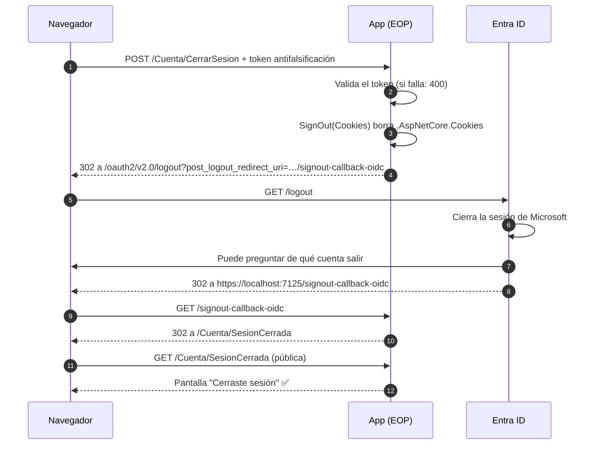

# 7. Cierre de sesión (S1-T09)

Cerrar sesión parece trivial ("borrar la cookie"), pero hacerlo bien tiene tres detalles: hay **dos sesiones** que cerrar, la acción tiene que estar **protegida contra CSRF** y Entra ID tiene que **tener permitido** devolver al usuario a la app.

## 7.1 Dos sesiones, no una

Cuando iniciás sesión se crean dos sesiones independientes:

| Sesión | Dónde vive | Qué pasa si no se cierra |
|---|---|---|
| **La de la aplicación** | Cookie `.AspNetCore.Cookies` en `localhost:<PUERTO>` | La app te sigue reconociendo |
| **La de Microsoft** | Cookies en `login.microsoftonline.com` | Al tocar "Iniciar sesión", Microsoft **te deja entrar sin pedir nada**, y parece que el cierre no funcionó |

La documentación de Microsoft lo dice así: para cerrar sesión hay que redirigir al usuario al endpoint de logout de Microsoft **y** limpiar las cookies de la app; *"If you fail to perform either of these operations, the user may remain authenticated"*.

## 7.2 Paso 1 — La acción CerrarSesion

Agregá esta acción a `CuentaController` (es la de EOP, sin los comentarios largos):

```csharp
using Microsoft.AspNetCore.Authentication.Cookies;

[HttpPost]
[ValidateAntiForgeryToken]
public IActionResult CerrarSesion()
{
    var propiedades = new AuthenticationProperties
    {
        RedirectUri = Url.Action(nameof(SesionCerrada), "Cuenta")
    };

    return SignOut(
        propiedades,
        CookieAuthenticationDefaults.AuthenticationScheme,
        OpenIdConnectDefaults.AuthenticationScheme);
}
```

**`SignOut(propiedades, esquema1, esquema2)`** le pide a ASP.NET Core que cierre la sesión en **cada esquema** indicado, en orden:

1. **`Cookies`** borra la cookie `.AspNetCore.Cookies`. Desde ese momento la app ya no te reconoce.
2. **`OpenIdConnect`** redirige el navegador al **endpoint de cierre de sesión** de Microsoft (`/oauth2/v2.0/logout`) con el parámetro `post_logout_redirect_uri`, que le dice a Microsoft a dónde devolverte.

**`RedirectUri = Url.Action(nameof(SesionCerrada), "Cuenta")`** es el destino **final**, después de que Microsoft termine (`/Cuenta/SesionCerrada`). `nameof(SesionCerrada)` evita escribir el nombre de la acción como texto suelto: si algún día se renombra el método, el compilador avisa.

> [!NOTA]
> `CerrarSesion` **no** tiene `[AllowAnonymous]`: para cerrar una sesión hay que tener una. Queda protegida por la política del capítulo 6.

## 7.3 Por qué POST: el ataque CSRF

**CSRF** (*Cross-Site Request Forgery*, falsificación de petición entre sitios) es un ataque en el que **otra página** hace que tu navegador mande un pedido a nuestra aplicación **sin que vos lo decidas**. Funciona porque el navegador agrega las cookies de la app automáticamente.

Si cerrar sesión fuera un enlace común (GET), bastaría con que cualquier página tuviera esto para cerrarte la sesión al abrirla:

```html

```

Cerrar la sesión de alguien parece una broma menor, pero el mismo truco aplicado a otras acciones (borrar, aprobar, cambiar datos) es grave. La regla es: **toda acción que cambia algo, por POST y con token antifalsificación**.

| Protección | Qué bloquea |
|---|---|
| `[HttpPost]` | Que la acción se ejecute con un enlace o una imagen (GET) |
| `[ValidateAntiForgeryToken]` | Que se ejecute con un formulario armado **en otro sitio** |

### Cómo funciona el token antifalsificación

1. Cuando la vista dibuja `<form asp-controller="Cuenta" asp-action="CerrarSesion" method="post">`, el *tag helper* agrega un campo oculto `__RequestVerificationToken` con un valor secreto, y la app deja además una cookie `.AspNetCore.Antiforgery.*` relacionada.
2. Al enviar el formulario viajan las dos cosas: el campo y la cookie.
3. `[ValidateAntiForgeryToken]` verifica que coincidan. Otra página puede hacer que tu navegador mande la cookie, pero **no puede leer** el valor del campo oculto de nuestra página, así que no lo puede falsificar.
4. Si no coinciden, ASP.NET Core responde **400 Bad Request** y la acción **nunca se ejecuta**.

El formulario de EOP está en `_EstadoSesionPartial.cshtml` (capítulo 5):

```cshtml
<form asp-controller="Cuenta" asp-action="CerrarSesion" method="post" class="d-inline">
    <button type="submit" class="nav-link btn btn-link text-dark">Cerrar sesión</button>
</form>
```

Las clases de Bootstrap `btn btn-link nav-link` hacen que el botón **se vea** como un enlace más del menú.

## 7.4 Qué es signout-callback-oidc

`/signout-callback-oidc` es la ruta de **tu** app a la que Microsoft devuelve al usuario **después de cerrar su sesión**. Igual que `/signin-oidc`, la atiende Microsoft.Identity.Web: no escribís ningún Controller. Al recibirla, la librería redirige al `RedirectUri` que indicaste en `SignOut` (`/Cuenta/SesionCerrada`).



## 7.5 Paso 2 — Configurar Azure para permitir el regreso

Microsoft solo devuelve al usuario a direcciones **registradas**. La documentación del endpoint de logout dice sobre `post_logout_redirect_uri`: *"This URL must match one of the redirect URIs registered for your application in the app registration portal."*

Por eso hay que agregar `https://localhost:<PUERTO>/signout-callback-oidc` como Redirect URI de la plataforma **Web** (capítulo 3, paso 4).

> [!ADVERTENCIA] Síntoma si falta
> La cookie de la app ya se borró en el paso anterior, así que la app ya no te reconoce. Pero el usuario se queda en una página de Microsoft, en lugar de volver a "Cerraste sesión" de EOP.

> [!EOP]
> Esta dirección se agregó en el portal durante la T09 y quedó indicada en la sección "Para el revisor" del PR #13.

## 7.6 Paso 3 — La pantalla "Sesión cerrada"

En el Controller:

```csharp
[HttpGet]
[AllowAnonymous]
public IActionResult SesionCerrada()
{
    return View();
}
```

Y la vista `Views/Cuenta/SesionCerrada.cshtml`, con Bootstrap y adaptable al celular (RNF-14):

```cshtml
@{
    ViewData["Title"] = "Sesión cerrada";
}

<div class="row justify-content-center">
    <div class="col-12 col-md-8 col-lg-6">
        <div class="card text-center mt-4">
            <div class="card-body">
                <h1 class="h4 card-title">Cerraste sesión</h1>
                <p class="card-text">Tu sesión en EOP terminó correctamente.</p>
                <a class="btn btn-primary" asp-controller="Cuenta" asp-action="IniciarSesion">Iniciar sesión de nuevo</a>
            </div>
        </div>
    </div>
</div>
```


.")

## 7.7 Comportamientos que conviene conocer

- **"¿De qué cuenta querés salir?"**: Microsoft puede preguntarlo. EOP no le manda una pista de qué cuenta es (`logout_hint`) ni el token anterior, así que Microsoft pregunta. Es normal.
- **El botón "Atrás"**: después de salir, el navegador puede mostrar una **copia guardada** de la página anterior. No significa que sigas con sesión: apenas recargás o hacés clic, la app te pide iniciar sesión. Evitar esa copia es una mejora opcional (capítulo 8).
- **Otras aplicaciones**: cerrar sesión en EOP termina la sesión de Microsoft para esta aplicación, pero otras aplicaciones (por ejemplo Outlook en la web) tienen **su propia** sesión y pueden seguir abiertas. Según la documentación de Microsoft, cerrar todas a la vez requiere configurar *front-channel logout* (single sign-out), que es una mejora opcional (capítulo 8).

> [!PRUEBA]
> 1. Con sesión iniciada, tocá **Cerrar sesión**.
> 2. Tenés que terminar en **"Cerraste sesión"**, con estilos.
> 3. En <kbd>F12</kbd> › **Application** › **Cookies**, ya no está `.AspNetCore.Cookies`.
> 4. Escribí la dirección de inicio de la app y dale Enter: te tiene que mandar a Microsoft, y Microsoft te tiene que **pedir la cuenta** (no entrar directo).
