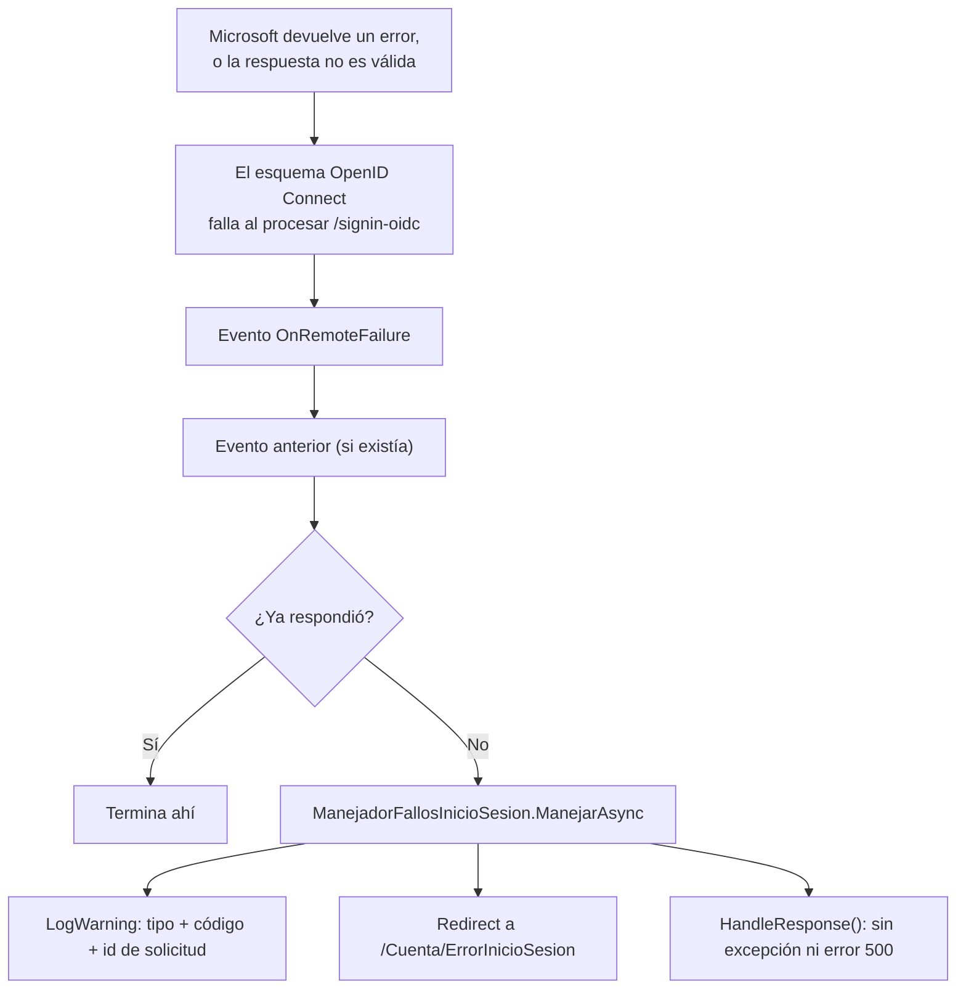

# 8. Manejo de errores y seguridad (S1-T09)

Este capítulo cubre dos temas: qué pasa cuando **el login sale mal**, y un repaso de **cada configuración de seguridad** que usamos, con lo que protege y lo que todavía se podría mejorar.

## 8.1 Qué pasa cuando el login falla

Hay dos lugares donde un login puede fallar:

| Dónde falla | Ejemplos | Qué ve el usuario |
|---|---|---|
| **En Microsoft**, sin volver a la app | Contraseña incorrecta, MFA rechazado en Authenticator, cuenta deshabilitada | Una página de Microsoft con el error. La app no se entera |
| **Al volver a la app** (`/signin-oidc`) | Microsoft devuelve `error=access_denied` porque el usuario canceló; faltan las cookies Correlation o Nonce; el `state` no coincide; el token no es válido | Sin manejo: **error 500**. Con el manejo de EOP: la pantalla **"No se pudo iniciar sesión"** |

En el segundo caso, el esquema OpenID Connect dispara el evento **`OnRemoteFailure`**. "Remote" se refiere a que falló la parte del proceso que viene **de afuera**, de Microsoft.

> [!NOTA]
> Microsoft documenta que, ante un error, puede responder a la Redirect URI con algo como `error=access_denied&error_description=the+user+canceled+the+authentication`. Eso llega a `/signin-oidc` y es lo que atrapa `OnRemoteFailure`.

## 8.2 Los eventos de Microsoft.Identity.Web

Un **evento** es un punto del proceso donde la librería te deja ejecutar código propio. El esquema OpenID Connect tiene varios: al redirigir a Microsoft, al validar el token, al fallar… Se configuran en `options.Events` de `OpenIdConnectOptions`.

EOP engancha `OnRemoteFailure` dentro del mismo `PostConfigure` que creó la T08:

```csharp
builder.Services.PostConfigure<OpenIdConnectOptions>(
    OpenIdConnectDefaults.AuthenticationScheme,
    options =>
    {
        options.ResponseType = "code";
        options.UsePkce = true;

        // Guardamos el evento que ya hubiera (por si la librería tenía algo
        // configurado) y lo ejecutamos primero, para no pisarlo.
        var eventoAnterior = options.Events.OnRemoteFailure;

        options.Events.OnRemoteFailure = async contexto =>
        {
            await eventoAnterior(contexto);

            // Si el evento anterior ya respondió, no hacemos nada más.
            if (contexto.Result?.Handled == true)
            {
                return;
            }

            var logger = contexto.HttpContext.RequestServices
                .GetRequiredService<ILoggerFactory>()
                .CreateLogger(typeof(ManejadorFallosInicioSesion));

            await ManejadorFallosInicioSesion.ManejarAsync(contexto, logger);
        };
    });
```

**¿Por qué guardar `eventoAnterior`?** Si simplemente asignáramos nuestro código, **pisaríamos** cualquier cosa que la librería hubiera puesto en ese evento. Encadenarlo es una práctica defensiva.

**¿Por qué `RequestServices` y no inyección por constructor?** `Program.cs` no es una clase con constructor. `RequestServices` es el contenedor de servicios **de la petición actual**: de ahí sacamos el `ILoggerFactory` para crear un logger.

## 8.3 ManejadorFallosInicioSesion

La lógica vive en una clase aparte, `Autorizacion/ManejadorFallosInicioSesion.cs`, para poder **probarla con una prueba unitaria** (capítulo 9):

```csharp
using Microsoft.AspNetCore.Authentication;

namespace EOP.Gestion.WebApp.Autorizacion
{
    public static class ManejadorFallosInicioSesion
    {
        public const string RutaPantallaError = "/Cuenta/ErrorInicioSesion";

        public static Task ManejarAsync(RemoteFailureContext contexto, ILogger logger)
        {
            var codigoError = contexto.Failure?.Data["error"] as string ?? "sin código";

            logger.LogWarning(
                "No se pudo completar el inicio de sesión con Microsoft Entra ID. " +
                "Tipo de error: {TipoError}. Código: {CodigoError}. Id de solicitud: {IdSolicitud}",
                contexto.Failure?.GetType().FullName,
                codigoError,
                contexto.HttpContext.TraceIdentifier);

            contexto.Response.Redirect(contexto.Request.PathBase + RutaPantallaError);
            contexto.HandleResponse();

            return Task.CompletedTask;
        }
    }
}
```

| Línea | Qué hace |
|---|---|
| `contexto.Failure` | La excepción que describe el fallo |
| `Failure.Data["error"]` | El **código corto** que mandó Entra ID (por ejemplo `access_denied`), si lo hubo |
| `LogWarning(...)` | Registra **tipo**, **código** e **id de solicitud**. A propósito **no** registra el mensaje ni la descripción, que podrían traer datos personales (RNF-12) |
| `TraceIdentifier` | Un identificador de la petición, para encontrarla en los logs |
| `Response.Redirect(...)` | Manda al usuario a la pantalla amigable. `PathBase` mantiene la ruta correcta si la app se publica en una subcarpeta |
| `HandleResponse()` | Le avisa a la librería "ya respondimos nosotros". **Sin esto, igual lanzaría la excepción** |

El registro que queda en la consola de Visual Studio se ve así (salida real con un fallo simulado):

```text
warn: EOP.Gestion.WebApp.Autorizacion.ManejadorFallosInicioSesion[0]
      No se pudo completar el inicio de sesión con Microsoft Entra ID. Tipo de error:
      Microsoft.AspNetCore.Authentication.AuthenticationFailureException. Código: sin código.
      Id de solicitud: 0HNPLPN14UB9R:00000001
```

"Sin código" aparece cuando el fallo no lo informó Microsoft sino la propia app. Por ejemplo, cuando la respuesta no trae un `state` válido.



## 8.4 La pantalla "No se pudo iniciar sesión"

La acción es pública (`[AllowAnonymous]`) y la vista muestra un mensaje **genérico** con un botón para reintentar. El detalle técnico queda en el log, nunca en la pantalla.

```csharp
[HttpGet]
[AllowAnonymous]
public IActionResult ErrorInicioSesion()
{
    return View();
}
```


> [!GENERAL]
> El patrón sirve para cualquier proyecto: **evento `OnRemoteFailure` → registrar sin datos sensibles → redirigir a una página pública → `HandleResponse()`**. Si no querés una clase aparte, el mismo código puede ir directo dentro del evento, aunque pierde la facilidad de probarlo.

## 8.5 Repaso de seguridad: qué implementamos y qué protege

| Configuración | Dónde | Qué protege | Requisito |
|---|---|---|---|
| Autenticación delegada a Entra ID | `AddMicrosoftIdentityWebApp` | La app nunca ve ni guarda contraseñas | RNF-2 |
| MFA en el tenant | Portal (Security defaults o Conditional Access) | Que una contraseña robada no alcance | RNF-3, RF-071 |
| Flujo de código + **PKCE** | `ResponseType = "code"`, `UsePkce = true` | El token no viaja por el navegador; un código robado no se puede canjear | — |
| **state** y **nonce** | Automático (librería) | Respuestas que la app no pidió y tokens reutilizados | — |
| **HTTPS** | `UseHttpsRedirection()`; `UseHsts()` fuera de Development | Que alguien lea o altere el tráfico | RNF-9 |
| Cookie **HttpOnly** | `options.Cookie.HttpOnly = true` | Que un script malicioso robe la cookie | — |
| Cookie **Secure** (Always) | `options.Cookie.SecurePolicy = CookieSecurePolicy.Always` | Que la cookie viaje sin cifrar | RNF-9 |
| **Todo cerrado por defecto** | `FallbackPolicy` | Pantallas nuevas olvidadas sin proteger | RNF-4 |
| **Validación de URL de retorno** | `Url.IsLocalUrl` + `LocalRedirect` | *Open redirect* | — |
| **Cierre de sesión por POST + token** | `[HttpPost]` + `[ValidateAntiForgeryToken]` | CSRF | — |
| **Cierre en Microsoft además de la app** | `SignOut(Cookies, OpenIdConnect)` | Volver a entrar sin credenciales después de salir | RF-069 |
| **Secreto fuera del repositorio** | User Secrets | Filtración del secreto en GitHub | RNF-11 |
| **Logs sin datos sensibles** | `ManejadorFallosInicioSesion`, `HomeController.Error` | Exposición de datos en logs | RNF-12 |

El fragmento de `Program.cs` de la cookie:

```csharp
using Microsoft.AspNetCore.Authentication.Cookies;

builder.Services.Configure<CookieAuthenticationOptions>(
    CookieAuthenticationDefaults.AuthenticationScheme,
    options =>
    {
        options.Cookie.HttpOnly = true;
        options.Cookie.SecurePolicy = CookieSecurePolicy.Always;
    });
```

> [!ADVERTENCIA] Consecuencia de `SecurePolicy = Always`
> La cookie **solo** se guarda y se envía por HTTPS. Si ejecutás con el perfil **http** (`http://localhost:5090`), el login no va a poder completarse. Usá siempre el perfil **https**.

> [!NOTA] Duración de la sesión
> EOP **no** configura cuánto dura la sesión: los requerimientos no lo definen, así que se mantiene el comportamiento por defecto de la librería. Definir un tiempo (por ejemplo, cerrar la sesión tras un período de inactividad) es una **decisión de negocio pendiente**.

## 8.6 Mejoras posibles que no están implementadas

Estas mejoras **no forman parte** de lo implementado en EOP. Se listan para que sepas que existen y puedas evaluarlas en otro proyecto o en una tarea futura:

| Mejora | Qué aporta | Comentario |
|---|---|---|
| **Certificado** en lugar de client secret, guardado en **Azure Key Vault** | Credencial más difícil de filtrar; Microsoft no recomienda secretos en producción | Necesario antes de producción |
| **Registros separados** para desarrollo y producción | Las Redirect URIs de `localhost` no quedan habilitadas en producción | Recomendación de Microsoft |
| **Duración de sesión** explícita | Sesiones que expiran por inactividad | Requiere una decisión del equipo |
| Encabezado `Cache-Control: no-store` en páginas autenticadas | Evita la "copia guardada" al apretar Atrás después de salir | Cosmético o de privacidad en equipos compartidos |
| **`logout_hint`** | Evita la pregunta "¿de qué cuenta querés salir?" | Requiere habilitar el claim opcional `login_hint` |
| **Front-channel logout** | Cerrar EOP cuando el usuario sale de otra app del tenant | Configuración en el portal y un endpoint en la app |
| Filtro global `AutoValidateAntiforgeryToken` | Protección CSRF automática para **todos** los POST futuros | Útil cuando haya muchos formularios |
| Verificar MFA desde la app | No depender solo de la política del tenant | **Previsto en la T11** |
| Rechazar usuarios no registrados o inactivos | Solo personas habilitadas en EOP | **Previsto en la T11** (con la vinculación de la T10) |
